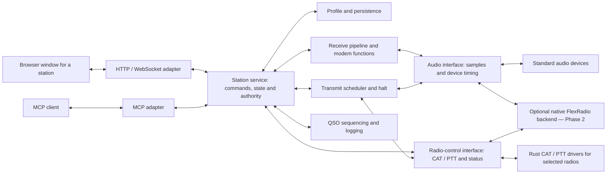

# Target product architecture

**Status:** target design for the queued functional CRs; not a claim that the planned
modules, interfaces or radio functions are implemented. **Layer:** WHAT.
The [FSD](WSTX%20Rust%20FSD.md) owns functional requirements and durable test definitions;
this companion owns component boundaries and internal interface responsibilities.
The [communication contract](COMMUNICATION.md) owns implemented wire schemas and limits.

## 1. Runtime shape

One station is one Rust server process, one explicitly selected persisted profile and
one listening endpoint. The browser runs locally or across the station link. A variable
number of station processes may run on a machine; four is a minimum reference workload,
not a fixed array size, launcher limit or radio-capacity promise.

The initial implementation stays in the existing Cargo workspace and server package.
Modules are introduced when their implementing CR needs them. Separate crates or services
require a demonstrated reuse, isolation or performance need; the diagram does not require
a crate per box.

The boxes show responsibilities within the station system, not a network hop for each
arrow. Optional coordination of a shared physical radio is described in section 5.

## 2. Responsibilities and dependency direction

| Logical component | Owns | Must not own | First CR |
|---|---|---|---|
| Bootstrap/profile | Profile selection, stable station identity, endpoint settings, exclusive profile ownership, validated configuration and storage | DSP or browser state | #5 |
| Station service | Authoritative station state, validated operations, active jobs, state transitions and operation authorization | HTTP/MCP parsing or device-specific protocol syntax | #5 |
| Web adapter | Embedded client, HTTP/file transfer and versioned WebSocket messages; transport authentication and Origin checks | A second QSO/modem engine or direct radio writes | #5–#6 |
| Browser client | Presentation, local display filtering, waterfall color/rendering, pending/stale state and operator requests | Authoritative radio state, timing-critical modulation or transmit authority | #5–#6 |
| Audio interface, sources and sinks | Validated recording input, live-device capture/playback, sample metadata and device errors | CAT commands, PTT commands, mode decoding or QSO decisions | #6, #8 |
| Receive pipeline/spectrum | Sample-window handling, mode-specific normalization/resampling, bounded receive jobs and spectrum products | File dialogs, HTTP, CAT or UI rendering | #6–#7 |
| Mode functions | Protocol-specific message/symbol/waveform and decode calculations with independent vectors | Filesystem, hardware, network or wall-clock dependencies | #7, #9, #11 |
| Radio-control interface and drivers | Selected radio capabilities, CAT/control operations, PTT mechanism, authoritative status and control-resource claims | Audio samples, sound-device operation, browser/MCP policy or duplicated modem logic | #8, #13 |
| Timing/transmit service | UTC mapping, scheduling, transmit state, audio/PTT coordination and priority halt | Dependence on browser timers or queued visualization work | #9 |
| QSO/logging | Exchange state, completion/cancellation and durable contact records | Bypassing transmit authority or another profile's storage | #10–#11 |
| MCP adapter/automation policy | MCP validation/authorization context and configured station-selection/automation requests | Independent station state, direct backend access or separate transmit permissions | #12 |

Transport adapters call station operations. Station operations call domain processing
and device/storage adapters. Pure mode processing does not depend on these outer adapters.
Browser and MCP requests cross the same station-side validation and authority boundary.

These are logical boundaries. Proposed Rust areas are profile, station, audio, receive,
modem, radio_control, transmit, qso, logging and api; names and file splitting follow the actual
responsibilities when implemented. Empty modules and speculative public APIs are not
part of this design.

## 3. Internal contracts to settle before dependent code

These are semantic contracts, not existing Rust types or a new wire version. The owning
CR defines concrete types, limits and error variants before code that consumes them.

| Contract | Required information and behavior | Owner / first consumer |
|---|---|---|
| Station context | Stable profile ID, display identity, validated configuration revision and runtime instance/boot identity. Ports and display names are not persistent identity. Secrets are not part of ordinary snapshots. | #5 / #6 onward |
| Operation and snapshot | Caller/authority context, correlated request/operation identity, result or defined error, current state revision and pending/completed distinction. Reconnection uses authoritative snapshots; it never replays an old transmit request. | #5 / web, later MCP |
| Receive input | Immutable sample blocks with explicit sample representation, rate, channel identity, sample position and discontinuity/end-of-stream information. UTC metadata is separate from the sample clock and may be absent for recordings. | #6 / #7 and #8 |
| Receive job | Profile, source, selected mode, immutable processing settings, bounded resources and cooperative cancellation. Results identify their job/generation; obsolete results cannot overwrite a newer source or mode. | #6–#7 / station service |
| Decode result | Mode/source/job identity, independently defined decoded content and applicable timing/frequency/signal measurements. Supported message variants and numerical tolerances belong to the mode contract. | #7 / browser, QSO and MCP |
| Spectrum frame | Source and sequence identity, frequency/time coordinates and bounded display data. Browser rendering does not require continuous raw audio over the remote link. | #6 / browser |
| Radio capability/control | Device/radio identity, supported operations, authoritative status, resource ownership and explicit failure/unavailable states. Unsupported capability never becomes a fabricated successful result. | #8 / transmit, later #13 |
| Transmit request | Profile/caller, current authority, mode/message, schedule and referenced radio resources. Halt and failure handling are local to the server. Link-loss policy and deadlines are settled before hardware transmit is enabled. | #9 / QSO, later MCP |
| Completed contact | Stable completion identity, agreed contact fields and explicit persisted/unsaved outcome. A replayed completion cannot silently create a second contact. | #10 / browser, MCP |

The initial audio contract supports the real-audio receive path needed by #6–#8. Future
wideband/IQ or multichannel modes use explicitly typed input capabilities; they must not
reinterpret complex samples as mono real audio. Likewise, modes are not forced into
FT8 timing or an interactive QSO workflow when those capabilities do not apply.
Mode capabilities distinguish receive, encode and operating-workflow support. The FT4
decoder in #7 does not enable FT4 transmission before #11; unsupported operations are
refused explicitly rather than silently using another mode.

The wire contract remains separate from these internal types. Each CR extending the
implemented status protocol updates COMMUNICATION.md first, including compatibility,
version/capability behavior, message limits and error handling. Internal station objects
are not serialized wholesale. Browser file transfer is separate from small control
messages; remote requests use profile-scoped recording identities rather than arbitrary
server filesystem paths.

## 4. State and data ownership

### Profiles and persistence

A profile owns its configuration, station identity, access configuration and contact/
recording metadata. #5 settles the schema/version, paths, recovery rules and atomic
write behavior before implementation. A held operating-system-backed ownership lock
prevents incompatible processes writing the same profile; stale-file existence alone
is not proof that a profile is still owned.

The profile is selected explicitly at startup and its effective identity is visible in
the browser. Starting a second profile does not mutate the first. Missing devices,
occupied ports or invalid configuration produce explicit failure without overwriting
another profile. Private credentials are never copied into status messages or browser
storage as part of a configuration snapshot.

Different TCP ports do not isolate cookies. #5 must define per-instance session routing
and credential verification for one shared browser cookie store; namespacing avoids
accidental collision but does not make same-host ports a trust boundary between hostile
services. The same-host multi-instance requirement assumes station processes under the
same operator's trust. Mutually distrusting deployments require a stronger origin/host
boundary. The [cookie contract](https://www.rfc-editor.org/rfc/rfc6265.html#section-8.5)
is the protocol constraint; the FSD owns the acceptance cases.

### Station operations and jobs

One station-state owner serializes authoritative transitions. Long-running processing
runs outside that state owner and returns job-tagged results. Input, completion and
cancellation are validated against the current profile, source and generation.

A client displays confirmed, pending and stale state separately. UI history/filtering
may be local; station configuration, received results required by workflows, radio state,
QSO progress and contact records remain server-owned. Reconnecting a client obtains a
new snapshot; late replies from replaced connections or cancelled jobs are discarded.

### Audio and CPU work

Recorded and live sources feed the same receive boundary. They differ in pacing and
clock metadata, not in whether they use a second decoder. Offline work uses sample
positions and a deterministic test clock where needed. Live work maps device/sample
time to UTC without asking browser timers to schedule radio operations.

The network executor is not a CPU-decoder queue. Processing concurrency, pending jobs
and sample buffers have explicit bounds, including an operator-visible worker/resource
budget for concurrent profiles. Automatic worker selection must account for multi-instance
use rather than assume each process owns the whole PC.

Cancellation is cooperative within bounded processing work. Timing-critical halt does
not wait for a decode job to finish. Unbounded use of blocking workers is not an adequate
CPU scheduler; Tokio documents both queue behavior and the inability to abort already
running blocking tasks in its [blocking-task contract](https://docs.rs/tokio/latest/tokio/task/fn.spawn_blocking.html).
Specific executors and acceleration libraries are chosen after workload measurement.
A correct CPU path remains required; GPU/SIMD backends implement the same processing
contract and must pass the same independent vectors.

## 5. Independent audio and radio-control interfaces

### Audio and control separation

The standard path has two independently configured and tested interfaces:

- **Audio:** input/output device and channel selection, sample movement, rate/timing
  metadata, buffering and device failure. It does not send CAT or PTT commands.
- **Radio control:** radio model/protocol selection, serial/network control transport,
  required frequency/mode/status operations and the selected PTT/split/VFO capabilities.
  It does not capture, generate or play audio samples.

The profile stores audio settings separately from radio-control/PTT settings. A valid
audio setup can be used with CAT disabled and manual tuning. A control connection can
report status or tune an approved radio without opening an audio device. Separate
capabilities and unavailable/error states prevent one working interface from implying
that the other is ready. A shared USB cable or network connection does not merge their
application responsibilities.

The transmit service coordinates both interfaces: obtain authority, prepare the selected
audio route and radio/PTT state, schedule output, and handle completion/halt/failure.
Audio failure must still leave the control-side halt/release path usable; control failure
must not produce a fabricated radio-ready state. Any supported VOX behavior is an explicit
transmit policy, not a hidden CAT dependency in the audio module.

### Scope of the Rust Hamlib replacement

The selected [WSJT-X beta build](https://github.com/WSJTX/wsjtx/blob/0f7d5928449ec747c3d1f6da1306f8c94404c3a9/CMakeLists.txt)
links Hamlib. [Hamlib](https://github.com/Hamlib/Hamlib/wiki) provides a common radio-control
API; WSJT-X documents [Radio and Audio](https://wsjtx.github.io/wsjtx/guide-full.html)
as separate configurations. These sources describe the reference responsibilities,
not source code to translate into this project.

Our radio_control module implements in Rust only the control behavior needed by this
program and its selected supported radios. #8 defines the first radio/protocol support
matrix and required operations; #9 adds the transmit-control behavior it actually needs.
Support grows when a functional requirement needs it. The target requires neither a
complete Hamlib port, its full radio/device catalogue, unrelated utilities nor compatibility
with its C API/ABI. The new module uses our station-facing contract and independent
protocol documentation/fixtures; no mandatory Hamlib library is part of this design.

Unsupported radio functions are explicit capabilities/errors. Optional interoperability
with an external control service, if selected in a later requirement, is another control
driver and does not couple audio to that service.

### Optional native FlexRadio implementations

The standard path is usable without FlexRadio hardware. Phase 2 implements the same
separate audio and radio-control interfaces through the native FlexRadio API without
external SmartSDR desktop/CAT/DAX bridges. The implementations may share a managed native
session and resource coordinator; they do not require a separate radio connection for
each interface and do not combine sample handling with control commands.

Station identity, a radio's physical identity, a slice association and a transient API
handle are different concepts. Persist intent; resolve current handles on connection.
Profile restoration must not guess a different slice or replay transmit intent.

Multiple station processes sharing a physical radio need one effective arbitration
authority for constrained resources and transmission. An in-process mutex in each
station is insufficient. Standard shared-device ownership is explicit in #8; #13 settles
native API leases, cross-process coordination and actual hardware/client limits before
enabling shared-radio operation. A project-owned common radio connector is permissible
if the verified API requires one; its lifetime must not depend on a station instance
whose shutdown should leave the other instances usable.

This phase-specific placement decision is contained behind the radio boundary. It
does not change browser, decoder, QSO or MCP contracts. #13 must verify the selected
radio/API capabilities before choosing the coordination implementation. A fixed four-GUI-
client design, simultaneous independent transmit assumptions or silently shared PTT are
not architecture contracts.

## 6. Thin-link and failure behavior

Small commands, acknowledgements, snapshots and decoded events have priority over
optional visualization products. The server generates reduced display data; JavaScript
renders/colors/filters it. A minimal profile can disable visualization. Raw input audio
is an explicit station input/transfer operation, not mandatory continuous browser traffic.

Queues have bounds and a defined full-queue policy:
- Commands are accepted, refused or failed explicitly; effects are not silently dropped.
- Obsolete spectrum frames may be replaced by fresher ones.
- Required state/QSO/decode information uses defined delivery/resync or explicit loss
  reporting; it is not treated like discardable display frames.
- New work is refused when its budget is exhausted. Existing instances remain serviceable.
- Active transmit stop/failure handling has a priority path and a specified local deadline.

No single-instance status test certifies aggregate audio/DSP or display traffic for N
instances. #6/#7 and later CRs define their workload, limits and measurement layer before
implementation. The implemented status-only budget and simulator limitations remain
canonical in COMMUNICATION.md.

Restart/disconnection cancels or marks affected operations unavailable according to their
contract. The transmitter defaults to unarmed on startup. #9 settles controller-loss,
device-loss and authority-expiry behavior before transmitting; #12 cannot invent a
different safety policy in the MCP layer.

## 7. Issue-to-architecture map

Roadmap priority and a technical prerequisite are recorded separately. This map is an
architecture orientation; the linked GitHub issues remain the work/acceptance backlog.

| CR | Components and contracts changed | Technical prerequisites | Integration proof |
|---|---|---|---|
| [#5](https://github.com/SensorsIot/wsjtx-rust/issues/5) | Bootstrap/profile, station context, visible identity, session isolation | Existing status foundation #3 | Independent profiles and windows at 1, 4 and a larger count; persistence and shared-browser isolation |
| [#6](https://github.com/SensorsIot/wsjtx-rust/issues/6) | Recording source, receive jobs, spectrum products, web transfer/display | #5 context/storage boundary | Actual recorded input through server and browser; analytical spectrum fixtures and bounded link behavior |
| [#7](https://github.com/SensorsIot/wsjtx-rust/issues/7) | Pure FT4/FT8 processing and receive-result contract | #6 sample/job contract | Independent mode-specific recordings/vectors and measured quality/runtime |
| [#8](https://github.com/SensorsIot/wsjtx-rust/issues/8) | Independent standard audio and Rust radio-control interfaces/drivers | #5 context and #7 receive pipeline | Offline-validated live input, CAT-disabled audio, audio-independent control and separate failure states |
| [#9](https://github.com/SensorsIot/wsjtx-rust/issues/9) | FT8 encoder, UTC scheduling, transmit authority/halt | #8 adapter contracts | Independent waveforms, deterministic scheduling, halt/failure fixtures and consented hardware verification |
| [#10](https://github.com/SensorsIot/wsjtx-rust/issues/10) | QSO state owner and contact storage | #9 | Complete FT8 exchange, cancellation and exactly-once logging |
| [#11](https://github.com/SensorsIot/wsjtx-rust/issues/11) | FT4 encode/timing and mode-specific workflow rules | #7 FT4 decoder and #10 common workflow | Complete FT4 workflow plus FT8 regression cases; shared UI/device/logging services |
| [#12](https://github.com/SensorsIot/wsjtx-rust/issues/12) | MCP adapter and configured automation policy | #10/#11 station-operation contracts | Browser/MCP state equivalence and identical station-side permission/cancellation behavior |
| [#13](https://github.com/SensorsIot/wsjtx-rust/issues/13) | Optional native radio/sample backend and shared-radio coordination | #5, #8 and #9 ownership/control contracts | Native API fixtures, mixed backend profiles and consented hardware tests; MCP is not a technical prerequisite |

Before each implementation, its issue settles the affected contract details and updates
the FSD/interface companion as needed. A change crossing a component boundary updates
its producer, consumers and independent tests together. Final validation uses the
integrated station, not only isolated module tests.

Pure processing and adapter fixtures can be developed independently once their shared
contract is settled. File ownership, separate working copies/build outputs, review and
serialized releases are governed by the [harness parallel-work process](https://github.com/SensorsIot/harness/blob/V2/core/docs/Parallel-Work.md);
this product map does not change that process.

## 8. Implementation state and design gates

The current source has a status-only Axum/Tokio server in
[server/src/main.rs](../server/src/main.rs), embedded
[client files](../client/index.html), native TLS and the existing status protocol/tests.
The planned modules and contracts above are introduced by their owning CRs.

Concrete profile schema and session names (#5), audio formats/sample representation and
display encoding (#6), decoder variants/quality budgets (#7), independent audio/control support matrices
(#8), transmit ownership/deadlines (#9), QSO/log format (#10), MCP tools/policy (#12) and
native FlexRadio coordination/capabilities (#13) are preparation gates. Their named
owners prevent two implementations from silently selecting incompatible contracts.
These are bounded implementation decisions inside the architecture, not claims of
completed hardware or mode support.
