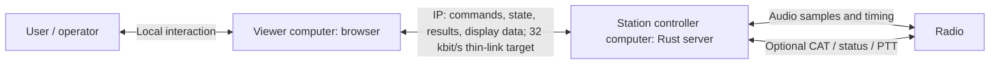
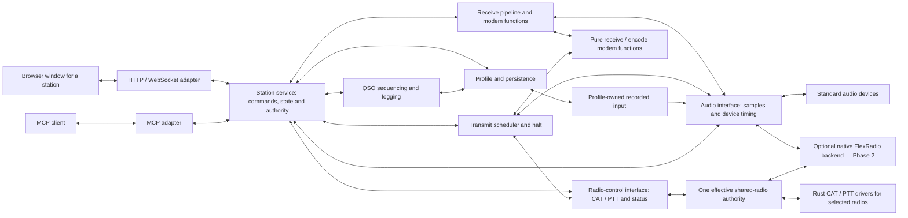

# WSTX Rust Functional Specification Document

- Status: Incremental functional specification; selected interface clauses and tests are defined below
- Created: 2026-10-24
- Working name: WSTX Rust
- Repository: https://github.com/SensorsIot/wsjtx-rust
- Behavior reference: WSJT-X `v3.3.0-beta4`, released 2026-10-22, commit `0f7d5928449ec747c3d1f6da1306f8c94404c3a9`
- Archived source snapshot: WSJTX/wsjtx, commit `967c85a6119110788b0df3782cf796485b2cee14` on `original`; this is not the beta behavior baseline.

Contents: [Requirements](#4-proposed-functional-requirements) |
[Acceptance tests](#6-acceptance-and-validation-approach) |
[11. Architecture](#11-target-product-architecture) |
[12. Communication contract](#12-station-communication-contract) |
[13. Recording reference data](#13-ft8-sample-recordings-and-provenance).

## 1. Purpose

Define the intended behavior and acceptance criteria for a simplified Rust implementation of WSJT-family functionality. The project must preserve on-air interoperability and the workflows needed for weak-signal amateur-radio communication, while keeping the implementation and user experience as simple as possible.

This is a starting specification, not a claim of implemented functionality. Confirmed decisions are listed separately from proposed requirements and open questions. Extract requirements from protocol publications, user documentation, release notes, and observable reference behavior. Write the Rust implementation independently rather than copying or translating the upstream source. Previous source inspection and shared repository history mean this process is not a claim of formal clean-room development.

## 2. Confirmed project decisions

- The project targets the upstream suite's useful functionality in Rust, with a simpler design; repository structure, internal APIs, and implementation details are not parity requirements.
- The primary product is a desktop application. Its first release targets Windows; macOS and Linux are planned desktop targets after the Windows release.
- The project has two applications in one repository: a Rust station server and an HTML/CSS/JavaScript browser client. Both can run on one development computer or on separate station and home computers.
- The station server owns radio state and timing. The browser renders the operator interface and communicates through a defined control/data interface suitable for limited-bandwidth links.
- An MCP interface provides access to the same station operations for FT4/FT8 automation, including station selection and QSO operation. Detailed tools and selection policies are defined in their implementing CRs.
- Use desktop CPU and memory resources effectively, including multicore execution and suitable hardware acceleration. Microcontroller resource limits do not set the primary product's design constraints.
- A microcontroller edition is a possible secondary product, with its own scope and resource limits. It is not part of the first Windows release commitment.
- The experimental behavior baseline is pinned to WSJT-X `v3.3.0-beta4`; newer betas require an explicit baseline update.
- Prefer a small application with shared modules. Add processes, crates, dependencies, or compatibility layers only when a concrete requirement justifies them.
- The `original` branch preserves the imported upstream source and history as a reference.

The imported upstream implementation remains on `original` and in Git history. The Rust
station server serves a browser status interface; radio functionality is outside the
initial communication slice. Development checks, the full automated suite and Windows
packaging run on the development PC. Hosted execution is an explicitly selected
alternative, not a second automatic run; see [project-specific harness instructions](harness/Project-Specifics.md).

### Behavior reference

The functional behavior reference is [WSJT-X v3.3.0-beta4](https://github.com/WSJTX/wsjtx/releases/tag/v3.3.0-beta4),
commit `0f7d5928449ec747c3d1f6da1306f8c94404c3a9`. The imported snapshot
`967c85a6119110788b0df3782cf796485b2cee14` on `original` is an archive, not the
current behavior target. Extract requirements from documented and observed behavior
and implement them independently in Rust. Attribution, distribution licensing and
branding notices are recorded in [the README](../README.md#license-and-attribution).

## 3. Scope

The intended end state covers the useful radio functionality represented by WSJT-X, MAP65, and QMAP. Supporting utilities are included when they serve an identified user or validation need; recreating every upstream file or executable is not a goal. Maintain a feature inventory with explicit decisions to include, merge, defer, or omit each capability. Delivery is incremental, with a small initial operating path.

### 3.1 Modes and protocols

The initial mode inventory includes FST4, FST4W, FT4, FT8, JT4, JT9, JT65, MSK144, Q65, WSPR, Echo, and the experimental JTTY mode. Exact variants, submodes, timing options, message types, and special operating modes must be inventoried against the pinned beta's behavior and documentation before implementation is declared complete.

### 3.2 Application capabilities

- Receive and transmit audio processing and digital signal processing.
- Encoding, decoding, synchronization, and protocol message handling.
- Station configuration, radio control, and transmit/receive sequencing.
- Spectrum and waterfall displays, decoded-message views, and operator controls.
- QSO workflows, logging, reporting, and external application integration.
- EME operation, Doppler compensation, and wideband workflows represented by MAP65 and QMAP.
- Supporting command-line tools, data files, documentation, and packaging needed to replace the upstream distribution.

### 3.3 Language boundary

The station server, radio logic, and protocol implementations are written in Rust. The browser client uses HTML, CSS, and JavaScript. Whether native operating-system interfaces, device drivers, or external libraries may be used through bindings remains an open decision. Retaining the existing Fortran or C++ implementation is not the final implementation goal.

### 3.4 Release targets

| Release direction | Target | Scope |
| --- | --- | --- |
| First release | Windows desktop | A usable operating path selected from the functionality inventory, with the existing Windows x64/MSVC build as the initial development target. Exact Windows versions and supported radio hardware remain open. |
| Subsequent desktop releases | macOS and Linux | Reuse the protocol and signal-processing components, adding and validating platform-specific audio, radio access, UI, packaging, and acceleration as needed. |
| Possible secondary edition | Microcontrollers and other constrained devices | Explore after the desktop foundation is established. Select the supported modes, hardware, memory budget, and interface separately; full desktop feature parity is not assumed. |

Keep protocol logic and input/output boundaries portable where practical. Platform-specific performance work is permitted behind those boundaries. Do not require every desktop feature to fit a microcontroller or require the initial Windows release to ship macOS, Linux, or embedded packages.

### 3.5 Station server and operator client

The [target architecture in chapter 11](#11-target-product-architecture) defines internal
component boundaries, data/state ownership, interface responsibilities and the mapping
of functional CRs to those components. This FSD owns functional promises, test-case
definitions and the [implemented wire contract in chapter 12](#12-station-communication-contract).
The architecture distinguishes the existing status/profile implementation from planned
receive, transmit, device and automation components.

| Application | Responsibilities |
| --- | --- |
| Station server, Rust | Runs beside the radio. Owns audio capture, decoding, encoding, transmit timing, radio control, QSO sequencing, and authoritative station state. Exposes shared station operations to the browser and MCP adapters. |
| Operator client, HTML/CSS/JavaScript | Runs in the operator's home browser. Renders spectrum/waterfall data and decoded messages, filters and sorts displayed results, presents controls and settings, and requests operations from the server. |

The applications share one repository and are versioned together initially. Their implementation directories are `server/` and `client/`; shared documentation and Cargo workspace files remain at the root. Same-machine development uses the same application boundary as remote operation.

The client-server interface carries commands, decoded messages, status updates, and reduced spectrum data. Continuous raw-audio or IQ transfer is not a prerequisite for normal remote FT4/FT8 operation. The server's radio timing is independent of network round trips and browser rendering.

The server reports actual station state; the browser distinguishes confirmed state, pending requests, stale data, and disconnection. Reconnection resynchronizes state before normal control resumes and does not replay old transmit requests. The loss-of-connection policy for an already active operation remains to be settled before remote transmission is implemented.

MCP accesses the same station operations and state as the browser. It supports observing and automating FT4/FT8 workflows, including finding candidate stations, selecting a suitable station, and conducting a QSO. Transport, tool names, authentication/authorization, control ownership, and selection policy are specified before the corresponding implementation. MCP does not define a separate modem or timing engine.

The initial status-only message contract and bandwidth/latency envelope are defined in
the [station communication contract](#12-station-communication-contract). Additional operating commands,
radio control ownership and optional desktop packaging remain to be specified. A browser
client is the initial interface direction; a Tauri or other desktop wrapper has not been selected.

### 3.6 Additional targets: configured instances and direct FlexRadio access

The following extensions build on the status-only communication slice. CR #5 now has
a phase-1 implementation candidate that passed independent code review and the local
Windows gate; live acceptance remains pending. Phase 2 remains specified future work.
Neither was delivered by CR #3.
Their phase numbers describe the requested
sequence for this extension, not completion of the broader delivery milestones.

- **Phase 1:** a variable number of independent station-server instances on the same
  Windows PC, each with its own port, persisted configuration and separate browser window.
  Four is a minimum acceptance target, not a fixed implementation limit.
- **Phase 2:** offer an optional direct FlexRadio connection type for a station profile,
  using the native network API and an intended radio/slice association for that profile.

The default connection path uses the ordinary WSJT-X-style audio-device interface,
with optional CAT/PTT rig control as required. Physical or virtual audio devices and
the operator's selected rig-control infrastructure remain supported. That standard
path may use external FlexRadio desktop/CAT/DAX software when the operator chooses it.
The optional native FlexRadio path removes those desktop bridges for profiles selecting it.

Each profile independently selects its connection type. Concurrent instances may
mix standard audio/rig-control and native FlexRadio profiles. Both paths use the same
HTML browser interface, station operations, DSP/modem functions and future MCP interface;
native FlexRadio support neither replaces the general product nor introduces a separate UI.

The number of logical station servers does not determine the number of FlexRadio
GUI-client connections, physical radios or independently usable transmitters. Shared-radio connection/resource
coordination may be implemented inside the Rust system. The supported radio and firmware
must actually supply the slice capacity needed by the selected operating scenario;
four slices are not assumed available on every FlexRadio model.

## 4. Proposed functional requirements

The broad requirements below are refined during the upstream inventory and their
implementing CRs. Section 4.1 specifies the selected FR-019/FR-021 status profile;
the other functional areas retain their proposed scope until settled.

| ID | Area | Required behavior |
| --- | --- | --- |
| FR-001 | Station setup | Configure and persist station identity, locator, devices, radio settings, and operating preferences. Validate values and explain invalid input. |
| FR-002 | Audio | Select supported input and output devices; capture receive audio and play generated transmit audio with the timing and sample handling required by each mode. |
| FR-003 | Receive processing | Process live audio and supported saved recordings; expose mode-appropriate filtering, synchronization, decoding options, and results. |
| FR-004 | Decoding | Decode the baseline mode and message variants, reporting available callsigns, locators, signal measurements, timing, and frequency information. |
| FR-005 | Encoding | Produce protocol-compatible messages, channel symbols, and waveforms for supported transmit modes and variants. |
| FR-006 | Time and sequencing | Schedule receive and transmit periods against UTC and apply each mode's timing rules. Surface clock or device problems that prevent reliable operation. |
| FR-007 | QSO operation | Support the baseline workflows for choosing a decoded station, preparing messages, progressing an exchange, and completing or aborting a contact. |
| FR-008 | Transmit control | Provide clear transmit state and an immediate halt action; handle PTT, radio errors, and device loss without leaving transmit active unintentionally. |
| FR-009 | Radio control | Support baseline radio-control capabilities, including frequency, mode, PTT, split operation, and supported device interfaces. The hardware support matrix is to be inventoried. The first hardware end-to-end test target is an Icom IC-7300 on a different PC; #8 must settle its setup and acceptance contract before the test. |
| FR-010 | Displays | Provide spectrum, waterfall, decode, frequency, and operating-state views sufficient to carry out the baseline workflows. Pixel-identical UI reproduction is not yet a requirement. |
| FR-011 | Logging | Record completed contacts and support the baseline log formats, import/export paths, and duplicate or prior-contact indications where applicable. |
| FR-012 | Integrations | Preserve required external protocols and message formats, including baseline UDP integrations and reception-reporting workflows. |
| FR-013 | EME | Provide baseline astronomical information, Doppler handling, and Echo measurement workflows applicable to each application. |
| FR-014 | Wideband reception | Replace MAP65 and QMAP capabilities, including supported wideband input, band maps, polarization processing where applicable, and coordination with the narrowband application. |
| FR-015 | Utilities | Identify the user and validation needs served by upstream utilities. Provide the selected capabilities through the smallest practical interface, documenting any required external compatibility. |
| FR-016 | Settings and migration | Persist Rust application settings reliably. Define compatibility and migration behavior for existing WSJT-X profiles before a user migration release. |
| FR-017 | Help and notices | Provide operating guidance, version information, relevant attribution, license access, and a clear indication that this is an independent port. |
| FR-018 | Recorded audio input | Load and validate recorded receive audio for repeatable processing, preserving source data and reporting unsupported or invalid input. The first recorded-input format, bounded import/replay workflow and tests are specified in4.4/6.4/12.6; implementation is pending. |
| FR-019 | Browser operator interface | Provide a modern HTML/CSS/JavaScript operator interface that can run on the home computer, rendering station information and sending control requests to the server. |
| FR-020 | MCP automation | Expose shared station operations through MCP for observing and automating FT4/FT8 activity, including station selection and QSO workflows. Exact tools and automation policies are specified in their CRs. |
| FR-021 | Station server and remote operation | Separate the Rust station server and browser client through a defined interface. Support same-machine development and remote operation over limited-bandwidth links, with authoritative server state, explicit connection status, and state resynchronization. |
| FR-022 | Concurrent persisted station profiles — phase 1 target | Support a variable number of independently startable/stoppable server instances on one Windows PC, using distinct listening ports, separate browser windows and isolated persisted configurations. Four is a minimum acceptance target, not a software limit. Preserve instance identity and access isolation across restart and concurrent use. CR #5 candidate implements phase 1 and passed independent code review and the local Windows gate; live acceptance remains pending. CR #3 did not implement profiles. |
| FR-023 | Optional direct FlexRadio integration — phase 2 target | Offer a selectable native FlexRadio TCP/UDP connection type alongside the default audio-device/optional CAT/PTT path. Native profiles operate without requiring external SmartSDR desktop/CAT/DAX applications, persist intended radio/slice associations and reconcile actual resources on connection. Both paths share the browser/DSP/MCP architecture. Specified target; not implemented or accepted by CR #3. |

### 4.1 Browser–server status functions

These stable clauses refine FR-019 and FR-021. The FSD is the canonical home of their
functional meaning and the test definitions in section 6.1. The clauses retain their
CL-003 identifiers independently of the GitHub issue lifecycle. Issue #3 records change
approval, implementation/review history and execution evidence; closing it does not
retire these clauses or tests.

This section also provides orientation to the detailed interface specification:
message schemas, field bounds, errors, authentication settings, timeouts, resource limits
and numerical traffic budgets have their single canonical home in
[chapter 12](#12-station-communication-contract). References below use that contract rather than
redefine its wire format or numeric limits.

| Clause | Promise | Required function | Verification |
|---|---|---|---|
| CL-003-01 | FR-019, FR-021 | The Rust server MUST serve the HTML/CSS/JavaScript operator client. The browser MUST visibly show server version, connection state and an unconfigured radio. Refresh status MUST request a fresh snapshot and update the displayed last-update time. | TC-021-006; TC-021-008 |
| CL-003-02 | FR-021 | Each browser MUST use one versioned WebSocket connection for status requests and responses. The server MUST echo each request ID on the requesting connection and return authoritative version/radio state. Concurrent clients MUST remain independent. | TC-021-005; TC-021-008 |
| CL-003-03 | FR-021 | The server MUST validate request structure, protocol version, command and message size in the contract's order. Rejected input MUST follow the defined error/close behavior; recoverable errors MUST leave the server available without exposing internal details. | TC-021-005 |
| CL-003-04 | FR-019, FR-021 | The browser MUST distinguish stale/disconnected state from current station state, detect a silently unresponsive connection, retry at a bounded rate and obtain a full snapshot before showing Connected again. Recovery MUST not wait indefinitely for an old socket to close. | TC-021-006; TC-021-007 |
| CL-003-05 | FR-021 | The minimal profile MUST support two clients sharing the contract's 32 kbit/s link model and meet its traffic and visible-response budgets. Tests MUST distinguish cold page/assets loading, protocol connection and displayed-status timing, and identify the measurement layer. | TC-021-008 |
| CL-003-06 | FR-021 | Application output buffering and active connections MUST have explicit bounds. An unresponsive client MUST be removed under the contract's liveness/write limits without blocking another client's status requests. Test results MUST distinguish observed liveness removal from an unobserved send-timeout branch or total-memory bound. | TC-021-008, stalled-reader variant; contract/source review |
| CL-003-07 | FR-021 | Remote access MUST use the contract's authenticated TLS path and exact Origin validation. The browser MUST offer token login, and invalid or oversized login requests MUST be refused. Insecure remote startup and invalid access settings MUST fail closed. Explicit loopback development MAY remain unauthenticated. | TC-021-009 |
| CL-003-08 | FR-019, FR-021 | Status MUST use initial/reconnection snapshots, explicit refresh requests and event-driven updates when state changes exist. The client MUST avoid constant status polling and tolerate protocol heartbeats between responses. The initial profile MUST carry no raw audio or spectrum stream and use no application-level compression. | TC-021-007; TC-021-008; peer-helper fixture; protocol/source review |

The initial workflow is open the station page, authenticate when TLS mode requires it,
receive a status snapshot, optionally refresh status and recover from connection loss.
It exposes no radio-control, transmit, decoding, spectrum or MCP commands. Those
functions remain governed by their broader requirements and implementing CRs. Future
spectrum delivery may use compact binary frames with adjustable resolution/rate and
discard obsolete frames; it is outside the status profile specified here.

### 4.2 Concurrent persisted station profiles — target FR-022

These are the profile clauses. The legacy environment-variable configuration and
single-instance status contract do not establish profile persistence or secure concurrent
four-instance operation.

1. The application MUST support a variable number N of independent station-server
   instances on the same Windows PC, without a fixed four-instance limit or fixed-size
   profile/window assumptions. Each MUST have a distinct listening port, its own
   persisted profile and an identifiable browser window. Four concurrent servers are
   sufficient for CR #5 acceptance; no 1/6-instance repetition is required. Practical capacity
   depends on available compute, memory, ports, devices and radio resources. Resource
   exhaustion MUST be reported without disrupting existing instances. Multiple windows
   connected to one server do not satisfy the independent-instance requirement.
2. Each profile MUST retain its instance identity and selected operating configuration
   across server/PC restart. Configuration edits and recovery of one profile MUST NOT
   modify another profile. The configuration format, storage location and editing workflow
   are selected before implementation; they are not defined by the current environment settings.
3. Each server MUST load the explicitly selected profile and fail clearly if its port
   is already occupied or its profile is concurrently owned incompatibly. A collision
   MUST NOT overwrite configuration or silently attach a browser to a different station.
   Stopping/restarting one instance MUST leave the other N-1 instances usable.
4. Access credentials, login state and station requests MUST remain isolated when the
   endpoints use the same hostname and the windows share one browser profile.
   Concurrent authentication and reconnection MUST not overwrite another instance's
   session or authorize a request to the wrong station.
5. Each profile MUST independently persist its connection type, defaulting to the standard
   audio-device/optional CAT/PTT path. Once the optional phase-2 type is implemented,
   standard and native FlexRadio profiles MUST run concurrently. Native radio/slice
   association fields apply only to a profile selecting the native FlexRadio type;
   they MUST NOT become required configuration for a standard audio/rig-control profile.
   The persisted association expresses operator intent, not an assumption that an
   observed runtime slice index remains stable after reconnect or radio restart.

HTTP cookies are not isolated by port; see
[RFC 6265, section 8.5](https://www.rfc-editor.org/rfc/rfc6265.html#section-8.5).
The legacy status-only mode uses the same cookie name/path across ports. Profile mode
addresses that shared-browser collision through 12.5; the original single-instance
authentication tests alone do not verify FR-022 clause 4.

#### CR #5 detailed contract — implemented candidate, acceptance pending

This approved target refines the five numbered clauses above and the approved roadmap
issue [#5](https://github.com/SensorsIot/wsjtx-rust/issues/5). The operator approved this
contract with four concurrent servers sufficient for acceptance. The implementation
candidate follows it and passed independent code review and the local Windows gate;
**live acceptance remains pending**.
Preparation proceeds Markdown requirements/tests
first, then SysML, a meaning comparison, code from the reconciled model, and verification
against these original Markdown expectations. Product code starts only after independent
Markdown/model readiness review passes. FR-001, FR-016, FR-019, FR-021 and FR-022 remain
the owning requirements; full station setup and legacy WSJT-X migration are later scope.

| Stable clause | Requirements | Approved target refinement | Cases |
|---|---|---|---|
| CL-005-01 | FR-022 | A selected profile owns one process/listener; N is variable and storage, process and browser collections MUST NOT assume four entries. Four concurrent servers are sufficient for CR #5 acceptance; the implementation has no four-instance ceiling. | `TC-022-001` |
| CL-005-02 | FR-001, FR-016, FR-019, FR-022 | Stable identity, schema, validated settings, revision and acknowledged saves MUST survive process restart. The browser MUST identify the selected profile and permit the bounded edits below. | TC-022-001; TC-022-002 |
| CL-005-03 | FR-019, FR-021, FR-022 | Profile lifecycle, revision, configuration and authenticated sessions MUST be independent, including one browser cookie store on one hostname with distinct TLS ports. | TC-022-001; TC-022-003; TC-022-004 |
| CL-005-04 | FR-016, FR-021, FR-022 | Ownership, invalid storage, occupied endpoints and unavailable startup resources MUST fail explicitly without replacing saved configuration or disrupting a running instance. | TC-022-002; TC-022-003 |
| CL-005-05 | FR-001, FR-022 | Standard audio with optional CAT/PTT remains the default. Audio and control selections MUST persist independently without claiming hardware availability. Native FlexRadio is reserved and refused in this phase. | TC-022-001; TC-022-002 |

**Selection and compatibility.** `wstx-rust --create-profile <directory>` creates a new
directory containing `profile.json`, assigns a fresh lowercase UUID v4 `profile_id`,
and exits successfully without listening. An existing directory is refused without
changes, including an empty directory. The parent directory MUST already exist. Normal
profile startup is `wstx-rust --profile <directory>`; a missing directory/file is an
error, never implicit creation or fallback. Relative directory arguments resolve against
the process working directory. Relative `WSTX_TLS_CERT` and `WSTX_TLS_KEY` runtime
paths also resolve against the process working directory in both startup modes; no TLS
path is stored in the profile file.
There is no default profile search, registry, profile import or automatic browser opening.
The operator opens the reported URL in a separate window for each selected instance.
Unknown/duplicated arguments and combining creation with startup are errors.

No-argument startup retains chapter 12's existing environment-only status mode and
`wstx.v1`; it does not claim persisted identity or satisfy FR-022. In profile mode,
`WSTX_BIND` and `WSTX_ORIGIN`, when present, are refused rather than overriding saved
settings. `WSTX_TLS_CERT`, `WSTX_TLS_KEY` and `WSTX_TOKEN` retain their chapter 12
runtime meaning; certificate/key paths are deployment inputs and MUST NOT be saved by
the settings form. This keeps secrets outside the profile and avoids migrating an
existing no-argument deployment implicitly. No settings are read from WSJT-X.

**Schema and defaults.** `profile.json` is one UTF-8 JSON object, at most 16,384 bytes.
Duplicate/unknown fields, unsupported versions, wrong types, malformed UTF-8/JSON,
out-of-range values and incomplete objects MUST be refused. These are its complete
schema-version-1 fields; all are required unless explicitly nullable:

| Field | Approved value/domain and creation default |
|---|---|
| `schema_version` | Integer exactly `1`. |
| `profile_id` | Lowercase hyphenated UUID v4, generated only on creation and immutable through application/browser operations; ports and labels are not identity. Offline UUID edits are unsupported. |
| `revision` | Integer 0 through 9,007,199,254,740,991; starts at 0, increments once per acknowledged settings save. Saving at the maximum is refused. |
| `display_name` | 1–64 UTF-8 bytes, no control characters or leading/trailing whitespace; default `New station`. Labels need not be unique; the UUID is always shown as well. |
| `callsign` | Empty (unconfigured), or 3–12 ASCII uppercase letters/digits/slashes containing at least one letter and one digit; default empty. No claim of national callsign eligibility. |
| `locator` | Empty, or Maidenhead length 4, 6 or 8: two A–R letters, two digits, optional two A–X letters, optional two digits; default empty. |
| `endpoint` | Object containing exactly `bind` and `origin`. `bind` is a numeric IP/socket port 1–65535; default `127.0.0.1:8080`. `origin` is null (derive bound loopback origin) or an exact origin under 12.1; default null. Profile mode refuses port zero so the endpoint survives restart. Non-loopback requires explicit HTTPS origin plus runtime TLS/token. |
| `connection_type` | String `standard` by default. `native_flex` is a reserved spelling, refused with `unsupported_connection_type`; no native association fields exist in this schema. |
| `audio` | Object exactly `{ "input_device": null, "output_device": null }` by default. Either value may instead be a nonempty opaque UTF-8 identifier of at most 256 bytes, without control characters. These are independent saved selections. |
| `control` | Object exactly `{ "mode": "disabled", "endpoint": null, "ptt": "disabled" }` by default. Mode is `disabled` or `cat`; endpoint is null when disabled and a nonempty opaque UTF-8 identifier up to 256 bytes without control characters when `cat`. PTT is `disabled` or `cat`, with `cat` requiring CAT mode. |

Profile mode supports direct browser-to-listener deployment. Its one effective browser
origin is the saved `endpoint.origin` when non-null; otherwise it is the bound loopback
IP/port with `http` or `https` according to runtime TLS. A saved origin MUST use the
runtime listener's scheme and the same numeric port as `endpoint.bind`; its hostname
may be `localhost` or a DNS alias resolving to the listener. Origin syntax still follows
12.1. Null origin is refused for non-loopback binding. Reverse-proxy port/scheme mapping
is outside CR #5. Readiness output, the URL opened by the operator, GET `/profile`'s
endpoint, visible browser endpoint and exact Origin validation MUST all use this same
effective origin. The numeric bind address remains the listener address, not an
alternative browser identity. These profile-mode rules do not change legacy 12.1.

UUID v4 generation follows the fixed normative reference
[RFC 9562, section 5.4](https://www.rfc-editor.org/rfc/rfc9562.html#section-5.4).
The HTTP methods/status semantics in 12.5 follow
[RFC 9110](https://www.rfc-editor.org/rfc/rfc9110.html); this FSD defines the narrower
profile behavior and error mapping. Cookie semantics remain the existing RFC 6265
reference above.

Audio/control identifiers express desired configuration only. CR #5 MUST NOT enumerate,
open or emulate working sound devices, radios, serial ports, CAT or PTT. Browser status
continues to say radio unconfigured and MUST label these selections `Saved; not activated`.
CAT-disabled audio is valid; selecting CAT does not prove audio exists, and selecting
audio does not prove control exists. Blank identifiers, invalid enum combinations and
unknown native fields are errors, not silently repaired defaults. Driver-specific serial,
radio and native-slice schemas belong to #8/#13 and require an explicit future version
decision; no invented hardware success or schema migration is part of CR #5.

**Ownership, saving and recovery.** One process exclusively owns a canonical profile
directory and its UUID for its full lifetime, including before accepting requests.
Ownership MUST use OS-backed locks released on exit/crash; mere lock-file existence
MUST NOT deny recovery. Directory aliases MUST converge on the same ownership claim;
concurrent copies with the same UUID on this PC MUST also be refused. Ownership keys
are local to the operator's OS account; this is not a hostile-user isolation mechanism.
No manual deletion of a stale marker is required after a process is killed.

Validate the whole profile, acquire ownership, validate required runtime TLS/token inputs
and bind the endpoint before reporting readiness. A failed launch exits nonzero with a
bounded diagnostic identifying the category and selected directory, never a secret;
it does not open a browser or attach to an existing instance. The following table is the
independent startup-error oracle. Each negative fixture introduces one listed fault;
there is no unspecified category choice for that fixture. Existing instances remain
available and `profile.json` bytes remain unchanged.

| Startup/creation fault | Required diagnostic category |
|---|---|
| Unknown/duplicate CLI option or combining create/startup; profile mode with WSTX_BIND or WSTX_ORIGIN present | `invalid_runtime_configuration` |
| Missing/unreadable selected directory or profile file; denied storage; absent creation parent; existing creation target including empty directory | `resource_unavailable` |
| Malformed/truncated JSON or UTF-8; duplicate/unknown/missing fields; wrong types; invalid UUID/settings; oversized file; bind port 0/65536; malformed origin; saved origin port differs from bind port; selected origin cannot satisfy the complete response budget in 12.5 | `invalid_profile` |
| Well-formed integer schema version other than 1, including 0 or 2 | `unsupported_schema` |
| Reserved `native_flex` connection type | `unsupported_connection_type` |
| Directory or UUID already owned, including aliases and copied directories | `profile_in_use` |
| Selected listener port already occupied | `endpoint_in_use` |
| Incomplete runtime TLS pair; TLS without token; token without TLS; token outside 32–128 ASCII alphanumeric bytes; non-loopback without explicit HTTPS origin/TLS/token; saved origin scheme differs from runtime TLS | `invalid_runtime_configuration` |
| Missing/unreadable/invalid certificate or private-key file; OS lock/resource acquisition failure other than held ownership; controlled allocation/bind failure other than occupied port | `resource_unavailable` |

Only the owning process writes settings. Browser saves validate a full editable settings
object plus expected revision, serialize against other saves, write a same-directory
temporary file, flush it, and atomically replace `profile.json` before acknowledging.
The previous complete document remains authoritative until replacement succeeds; the
new complete document becomes authoritative after success. No truncated document may
be acknowledged. A write/replace failure retains the previous revision in memory and
on disk, reports an error, and leaves the running server available. A lost response after
a successful replacement is resolved by reloading the authoritative settings, not
automatically replaying the edit. Concurrent edits with an old revision are refused.
External file edits while owned are unsupported and MUST NOT be used as a second writer.

Crash recovery reads only `profile.json`; leftover temporary files are ignored and never
promoted automatically. A missing, corrupt or future-version file fails closed without
rewriting it or another profile. With the process stopped, the operator restores a known
good complete copy to the same path, or creates a new profile in a new directory. No
automatic backup selection, destructive reset, cross-profile copying or legacy migration
is implied. Persistence covers restart after an acknowledged save and an orderly OS
restart; recovery from arbitrary storage failure or sudden power loss is not promised.
After an OS restart the operator explicitly starts the same profile again; automatic
startup/service installation is outside this CR. In schema text, control characters
mean Unicode U+0000–U+001F and U+007F–U+009F; all length limits stated in bytes use UTF-8.

**Browser workflow.** Profile mode displays full UUID, display name, actual endpoint,
boot identity and saved revision alongside existing connection/radio status. A boot
identity is a new lowercase UUID v4 for each successful start and is not persisted.
The document title contains display name and port; the full UUID is visible in the page.
The settings form edits `display_name`, `callsign`, `locator`, `audio` and `control`
only, as a whole revision-checked save. UUID, endpoint, connection type, schema and
revision are read-only; endpoint changes are validated offline edits while stopped.
All profile-supplied names and identifiers MUST render as literal text, never parsed
HTML, executable script or unsafe attribute markup, including in titles and form errors.
The connection-type control shows `Standard` and `Native FlexRadio — reserved`, with
the latter disabled. Validation errors identify the invalid field, preserve typed input
and MUST NOT report Saved. Successful saves show the new revision only after durable
acknowledgement; another window reloads the authoritative form on Refresh/reconnect.
No periodic settings polling or new hardware access is added.

The HTTP settings and session refinement in [12.5](#125-profile-interface-for-cr-5)
is part of this approved target. The wider physical/software architecture and ownership
boundaries in chapter 11 remain applicable. This subsection settles only the #5 slice;
it does not assert complete product or model implementation readiness.

### 4.3 Optional native FlexRadio integration — target FR-023

FlexRadio documents direct TCP command/status access and UDP streaming, and lists its
native API separately from the Windows .NET FlexLib option. These are the integration
starting points, not a promise that every model/firmware offers identical resources:
[developer program](https://www.flexradio.com/api/developer-program/),
[API overview](https://www.flexradio.com/api).

1. Phase 2 MUST offer direct native-network integration as an optional profile connection
   type for the selected radio control, status and sample-stream functions. When selected,
   that native path MUST NOT require the external SmartSDR desktop application, SmartSDR
   CAT or DAX applications to be installed/running as bridges. This restriction does not
   prohibit those tools as operator-selected infrastructure for the standard connection
   path. A Rust implementation may coordinate
   shared radio access internally without forcing one hardware GUI-client session per
   logical station server.
2. This independence concerns desktop applications. Compatible radio-side firmware and
   its API remain required; this specification does not promise a FlexRadio operating
   without its SmartSDR radio firmware or an unrestricted firmware compatibility range.
   Pin supported models, firmware/API versions and selected stream formats before implementation.
3. Each native FlexRadio profile MUST persist its intended radio and slice association. On every
   connection/reconnection the system MUST reconcile that intent with authoritative
   discovery/status and current runtime handles. A changed/transient slice index MUST
   NOT redirect a station to another station's slice. Unresolvable associations MUST
   produce a visible unavailable/conflict state rather than guessing a replacement.
4. Control responses and received stream data MUST be routed to the associated station.
   Capacity shortages, occupied resources and incompatible API behavior MUST be reported
   without stealing another profile's slice or silently reducing the requested independence.
   Four-slice hardware validation requires a model/configuration that actually provides
   at least four usable slices.
5. Shared-radio transmit, tuning and other constrained-resource authority MUST be
   coordinated under FR-008/FR-009 before those operations are enabled. Four station
   profiles do not confer simultaneous independent transmit authority. Reconnect/profile
   restoration MUST NOT replay an old transmit request or bypass the future ownership policy.
6. The native path MUST reuse the common browser, station-operation, DSP/modem and future
   MCP interfaces. The default standard connection remains usable without FlexRadio
   hardware or native-profile fields. A mixed set of instances MUST preserve each
   profile's selected path, configuration and routing independently.

### 4.4 Offline FT4 and FT8 receive milestone — target FR-003/FR-004/FR-018

The offline receive milestone MUST cover both FT4 and FT8. It MUST load supported
recorded audio, allow explicit mode selection and display decoded messages with the
mode-appropriate measurements. It MUST run without a physical radio, audio device or
real-time reception schedule. Both modes use the common receive pipeline and browser
presentation, with their own protocol-specific processing and acceptance vectors.

Supported recording formats, message variants, numerical tolerances, decoder-quality
and runtime budgets MUST be settled before implementation. Each mode needs independently
established expected results and licensed, traceable recordings; FT8 fixtures do not
establish FT4 correctness. This is a planned milestone, not an implemented decoder.

#### CR #6 recorded-input and display contract

This is the authorized minimal first-version contract, with independent cases in6.4
and its communication extension in12.6. Source compatibility has been checked against
the 22 pinned mono 12kHz PCM16 reference recordings. No feature implementation or
passing behavior is claimed. Implementation begins only after independent Markdown/
SysML meaning and readiness review; that review remains pending.

| Clause | Requirements | Promise | Verification |
|---|---|---|---|
| CL-006-01 | FR-003, FR-018 | Import only the bounded WAV capability below; preserve original bytes and expose immutable, explicitly timed samples without a codec or implicit resampler. | TC-018-001; TC-018-002 |
| CL-006-02 | FR-018, FR-019 | Profile-owned import/replay/cancellation have explicit pending, terminal and recoverable error states; replacement never destroys the previous committed source before commit. | TC-018-001; TC-018-002; TC-018-003 |
| CL-006-03 | FR-010, FR-019, FR-021 | Show measured spectrum and source-time waterfall together above station controls in one station page; use the defined axes/math, accessible divider and bounded optional thin display. | TC-010-001; TC-010-002; TC-010-003 |
| CL-006-04 | FR-021 | Bound import, sample, worker and visualization resources; refuse excess work explicitly, discard obsolete display work, preserve status service and invalidate late receive output on cancellation/replacement. | TC-018-002; TC-018-003; TC-010-002 |

**Input capability.** RIFF/WAVE little-endian integer PCM format tag 1,
mono, 16 bits/sample, exactly 12,000 samples/s; 1 through 1,440,000 source frames
(120 seconds), at most 3,145,728 file bytes. Require one `fmt ` before one nonempty
`data` chunk, PCM format size 16 or 18 with zero extension length, block alignment 2,
byte rate 24,000 and an even data length. RIFF size plus eight equals actual file length;
all chunk lengths and odd-length padding remain inside that length. Accept at most 64
chunks total, skipping other bounded chunks without interpreting metadata. Reject
RF64/RIFX, extensible/compressed/float formats, stereo, other rates, duplicate required
chunks, inconsistent sizes and truncated headers/data/padding. Unknown ancillary chunks
alone do not make otherwise valid input unsupported. Preserve the entire original file,
including ancillary chunks. This deliberately narrow capability needs no codec/resampler;
the pinned recorded fixtures satisfy it. Device rates and future
import formats remain separate capabilities, not coercions into this format.

**Source persistence.** One committed original/metadata pair per selected
profile, one pending import reservation and no recording library. Store under a confined
profile-owned recording area, using server UUID-derived names, never client paths or
filenames. Metadata schema version 1 (at most1024 UTF-8 bytes) records recording UUID, file byte count, frame count
and rate; sample bytes remain the original WAV. Manifest schema version 1 (at most256 UTF-8 bytes) contains exactly
`schema_version:1` and `recording_id`; the UUID derives the original/metadata filenames.
Per-source metadata contains exactly `schema_version:1,recording_id,file_bytes,frames,rate_hz`.
No credentials or arbitrary path is stored in these records. Flush validated original/metadata before
atomically switching the current-recording manifest; that manifest replacement is the
commit point. A failed/cancelled pre-commit import leaves the previous source unchanged.
After commit the new source is authoritative even if the response is lost; obtain a fresh
snapshot rather than automatically repeat the mutation. Keep at most old and pending/new
originals during replacement; remove obsolete/temp files after commit and on restart.
Cancellation invalidates publication/commit authorization before its HTTP acknowledgement;
accepting that operation and constructing its response take at most250ms locally,
excluding network transit. Normal cleanup finishes within1s in isolated Windows tests.
After an I/O error or5s cleanup deadline, publish failed/storage_unavailable and set
storage_error; keep the pending files/handles quarantined and retain the one occupied
operation/worker slot. Refuse further import/replay with503 storage_unavailable until
cleanup actually succeeds or restart reconciles the directory. Do not claim deletion,
start replacement workers or revert an already committed source. A blocked OS call may
finish later, but its invalidated token cannot commit; final release clears storage_error
only after real cleanup. Status/profile/settings and cancellation observation stay usable.
Restart attempts cleanup once before enabling imports; failure keeps the degraded state.
These are bounded application outcomes, not a claim to interrupt a blocked Windows I/O
system call. A commit already begun is reconciled via snapshot, not cancelled. A corrupt/missing committed
source is `recording_unavailable`; the authenticated recording snapshot remains200 with
`recording:null` and `source_error:"recording_unavailable"`, preserving current identity,
generation and operation state so a fresh browser can replace it. Profile/status/settings
remain available and no source is fabricated. Restart preserves the committed recording ID/bytes and changes boot ID. The fresh
boot starts with generation0, `import:null` and `job:null`; prior reservations and jobs
are forgotten. Interrupted replay is invalidated by the changed boot identity, with no
durable cancelled-job record, synthetic replacement job or persisted cancellation marker.
Old import/job IDs return404; no automatic replay occurs. Cleanup/source failures retain
their explicit error fields without recreating a pending operation. Only the declared
source metadata/manifest/original persist; receive operations remain boot-local.

**Immutable receive boundary.** Semantic schema version 1, initially mono real
finite `f32`; conversion is exactly signed PCM16 / 32,768 (including -32,768 -> -1).
The source descriptor contains profile/boot/source UUIDs, integer rate in samples/s,
channel `mono_real`, nullable total frame count and nullable UTC anchor. Recording UTC
is null; filenames never imply UTC. A block contains source identity, first source-frame
index (`u64`), read-only samples, discontinuity and end-of-stream. An owned shared
read-only slice (`Arc<[f32]>` or equivalent immutable ownership) owns its allocation;
consumers hold references only for the active processing step. Producer reuse waits for
all references to release. A block holds at most 4,096 samples; the #6 path retains at
most two such blocks for #6 spectrum jobs, including producer/consumer ownership, with
no whole-recording float array or reader backlog. This spectrum-path retention bound
does not prohibit #7 modem working history: #7 must separately specify its bounded
retained windows/storage, ownership and cancellation before decode implementation. EOS marks the last nonempty block; source frame positions
are contiguous for recordings, starting at zero; discontinuity is false. A future live
producer declares its gaps explicitly and must settle its own bounded loss policy before
implementation. Integer-to-real unit conversion is not AGC or modem normalization.
The shared receive pipeline owns any later #7 rate conversion/preprocessing; pure modem
functions have no WAV/device knowledge. An incompatible sample semantic change requires
a new contract version and coordinated producer/consumer review, not reinterpretation.

**Receive lifecycle.** One active import OR replay per station, one CPU worker,
no pending job queue; concurrent start gets `busy`. State owner transitions and token
checks serialize; CPU/file work does not hold the state owner or profile-settings lock.
A replay job has schema 1, profile/boot/source/job UUIDs, station generation (`u64`,
wire-safe 0..9,007,199,254,740,991), kind `spectrum`, immutable settings, processed frame
count and cooperative cancellation. #7 adds a separately approved decode settings kind
using the same receive lifecycle. States are `running`, `cancelling`, `completed`,
`cancelled`, `failed`; terminal progress remains in the snapshot until another job starts.
Starting an import or replay allocates a fresh station generation; starting replay also
allocates a fresh job UUID. Cancellation invalidates publication before returning its
acknowledgement; every receive terminal transition follows worker release. For a
current running job with no accepted cancellation, a processing failure remains
nonterminal while the worker is held, then transitions to failed after release;
it cannot become completed even if source EOS/completion is also observed. Completion
requires source completion, worker release and absence of processing failure. These
rules preserve the existing serialized cancellation/state ownership, rather than adding
another cancellation priority policy. Do not reuse a generation
on wrap; refuse new work with `generation_exhausted`. Every publication matches current
profile/boot/source/job/generation. A prior job's completion/frames cannot replace the
current snapshot. Source UUID is the persistent recording UUID, not a replay identity.
Receive cancellation does not govern transmit authority or delay #9 halt.

Spectrum replay in #6 is explicit, server-paced at source time (1x) for inspection,
not speaker playback and not a radio operation. This pacing applies only to spectrum
jobs; #7 must settle its offline decode pacing/runtime and bounded modem working history
independently, using the same immutable source/sample and receive job identities. Completion occurs within1s after the source duration on the stated Windows workload,
including final processing. Another browser may observe/cancel the same station-owned job. Browser
closure/link loss removes its subscription; it does not cancel an accepted replay.
Cancellation checks are at most 50 ms apart and worker release/terminal state occurs
within 250 ms after cancellation is accepted, measured on the recorded Windows test PC
with four profile processes and one active worker each. No hardware/global CPU-count
auto-allocation is introduced. The UI reports the one-worker-per-station budget.

**Independent display definition.** For 12 kHz input, use 2,048 real samples per
window, hop 256 source frames, periodic Hann `w[n]=(1-cos(2*pi*n/2048))/2`; windows start
at source frames 0,256,... while their start is before EOS. Right-pad the final partial
windows with zeros, retaining actual source end in metadata. DFT convention is
`X[k]=sum(x[n]*w[n]*exp(-i*2*pi*k*n/2048))`. Peak amplitude is `2*abs(X[k])/sum(w)` for
positive interior bins and `abs(X[0])/sum(w)` for DC. Level is
`20*log10(max(amplitude,10^(-120/20)))`, clipped to [-120,0] dBFS. This is calibrated
peak-amplitude dBFS, not power density, SNR or receiver RF power. FFT output must agree
with this independent definition regardless of the jointly selected provider. The joint
technical selection is RustFFT **6.4.1** for both #6/#7: complex unnormalized
forward negative-sign/inverse positive-sign transforms, DC-first ordering and caller-owned
scaling. Use CPU `FftPlanner<f32>` for the normal path; retain an independently checked
`FftPlannerScalar<f32>` portable path. A worker copies/window-converts source data into
its own complex buffer, obtains `get_inplace_scratch_len()` for the plan and reuses
worker-owned scratch with `process_with_scratch`; neither mutable buffer aliases the
original immutable samples. #6 fixes N=2048; #7 owns its supported transform sizes and
bounded modem working history. Plan once per needed size/worker, never per display row;
check lengths before processing so invalid input cannot reach a panic precondition.
No generic FFT wrapper or additional RealFFT dependency is needed. This is the central
owned dependency contract; future crate adoption is implementation work, not performed
by this document. Normative primary API: [RustFFT6.4.1 normalization/output order](https://docs.rs/rustfft/6.4.1/rustfft/),
[`Fft` scratch/buffer contract](https://docs.rs/rustfft/6.4.1/rustfft/trait.Fft.html) and
[`FftPlannerScalar`](https://docs.rs/rustfft/6.4.1/rustfft/struct.FftPlannerScalar.html).
The explicit DFT formula above fixes sign/scaling independently of the provider.

Expose 128 groups over [0,3000) Hz: group b is bins 4b..4b+3, each original bin separated
by 12000/2048 Hz; group interval is [b*23.4375,(b+1)*23.4375) Hz. Retain maximum amplitude
before converting to dBFS. One waterfall row covers each one-second source interval
[j,j+1), shortened at EOS, taking maxima of windows whose start falls in that interval.
Consequently window support can extend into the next interval; this smoothing is part
of the time oracle. The spectrum is the same row's one-second peak hold. Quantize level
as `floor(clipped_dBFS+120+0.5)` to integer 0..120; decoded level is q-120 dBFS with at
most 0.5 dB quantization error. A 0.5-amplitude coherent tone has approximately -6.0206
dBFS before PCM quantization, not a code-generated golden value. Silence is -120 dBFS.
Label frequency in Hz, time relative to recording start in seconds and level in dBFS.
Show gaps on skipped row sequences; never interpolate a missing row as observed signal.
Browser retains at most 120 rows of 128 values; replacing the source/job clears history.

**Integrated UI.** One browser window/page per station. Spectrum and waterfall
occupy the upper pane; profile/status/import/replay/controls and future decoded messages
occupy the lower pane. No placeholder decoded messages or signal data. Horizontal
separator is focusable with `role=separator`, horizontal orientation, accessible name,
current/min/max pane sizes and visible focus. Pointer/mouse/touch drag changes upper
height; Up/Down change it by 16 px, Home/End select min/max. Minimum upper/lower pane
heights are 160/200 CSS px excluding a 12 px separator. If available height is smaller,
scroll the page rather than violate minima. Lower controls also scroll independently
when needed. Initial split is 50% of available height clamped to minima. Recompute/clamp
on viewport changes; no server persistence of pane size. Verify 1100x850 and 360x640,
keyboard-only use, touch input, 200% zoom and literal rendering of source/status text.
No horizontal page overflow; axis labels and primary controls remain reachable.

### 4.5 Separate audio and radio-control functions — target FR-002/FR-009

Audio and radio control MUST be separate, independently selectable interfaces with
independent settings, capabilities, availability and errors. Audio capture/playback MUST
remain usable with CAT disabled and manual tuning; supported radio status/control MUST
be usable without opening an audio device. The transmit service coordinates the selected
audio route and PTT mechanism under FR-008 rather than hiding control operations in audio.

The Rust radio-control module MUST implement only the Hamlib-like behavior actually
required by this program for its selected supported radios. The initial support matrix,
protocols and operation subset are settled in #8 and extended by actual later requirements.
This requirement does not call for Hamlib's full API/ABI, device catalogue or utilities.
Detailed component responsibilities and reference sources are canonical in
[the architecture](#115-independent-audio-and-radio-control-interfaces).

Optional native FlexRadio support supplies the same two interfaces; shared physical
transport/session management does not merge their sample and control responsibilities.

The selected first hardware end-to-end target above belongs to #8's planned
TC-009-002 controlled live receive/CAT test; transmit testing follows separately in #9.
Preparation in #8 must settle the exact radio/firmware, station PC and operating system,
audio devices, independent audio/control transports, browser placement, test steps and
measurable acceptance criteria. No USB connection or browser host is assumed. Target
selection establishes neither test readiness nor a passing result; live execution still
requires operator consent.

#### Planned interface-independence tests

| Test | Promises | Inputs/actions | Expected result/oracle | Level / where it runs |
|---|---|---|---|---|
| TC-002-003 — Audio without CAT | FR-002, FR-009 | Feed known receive samples through a device fixture with CAT disabled; inject audio-device loss. | The receive pipeline accepts the known samples without control traffic; audio availability/failure is explicit. | 2 — Isolated automated tests; Windows PC, real candidate pipeline and independent device/control fixtures. |
| TC-009-003 — Control without audio | FR-002, FR-009 | Connect an independent CAT protocol fixture with audio closed/unavailable; exercise only selected supported queries/settings. | Expected control exchanges/status succeed without opening audio; unsupported functions and timeouts follow the defined capability/error contract. | 2 — Isolated automated tests; Windows PC, Rust control module and protocol emulator. |
| TC-009-004 — Independent failure and coordination | FR-002, FR-008, FR-009 | Lose each interface separately; observe the other; use simulated active transmission and halt. | Separate availability is preserved, failed control is never shown ready, and transmit failure/halt releases through the configured control path according to the agreed policy. No real RF transmission. | 2 — Isolated automated tests; Windows PC, independent audio and radio-control emulators. |

### 4.6 Functional model

The functional SysML companion represents the product requirements, architecture and
verification intent. Its purpose is a sufficient functional contract for AI implementation
of each approved slice. Current coverage and unresolved design ownership are in the
[architecture](#1111-functional-model-and-views).
Model-authoring and maintenance procedures are defined in the
[project-specific harness](harness/Project-Specifics.md#project-model-documentation-contract),
which links the general SysML instruction. Harness procedures are not part of the product model.

## 5. Proposed quality and compatibility requirements

- **On-air compatibility:** Preserve the protocol definitions and interoperability of the selected upstream baseline. A language rewrite must not silently change message encoding or waveform conventions.
- **Decoder quality:** Measure decoding success, false positives, sensitivity, and runtime against reference recordings and controlled signals. Numeric tolerances and acceptance thresholds must be agreed per mode.
- **Timing:** Meet each mode's receive and transmit deadlines on a documented reference machine. Hardware and performance budgets remain to be selected.
- **Platforms:** Windows is the first release platform. macOS and Linux are subsequent desktop targets. Supported operating-system versions and CPU architectures remain open beyond the initial Windows x64 build environment.
- **Reliability:** Recover from device and connection errors with understandable status information; preserve settings and logs across ordinary restarts.
- **Maintainability:** Keep protocol and signal-processing logic testable independently of the graphical interface and physical radio hardware.
- **Licensing:** Choose dependencies compatible with distribution of the port under GPLv3 and retain applicable third-party notices.

### 5.1 Desktop performance and acceleration

- **Multicore execution:** Use a bounded pool of CPU workers for independent decode work and other suitable tasks. Support automatic worker selection and an operator override, keeping enough capacity for audio, radio control, and the interface. Preserve ordering where processing stages depend on earlier results.
- **CPU optimization:** Evaluate optimized FFT processing, data layout, buffer reuse, and SIMD where profiling identifies a useful benefit. Select instruction-specific paths according to the processor's capabilities and retain a portable CPU path.
- **GPU and other accelerators:** Allow optional acceleration for suitable workloads, such as batched signal processing or spectrum generation. Select APIs and backends after cross-platform feasibility checks and benchmarks; no CUDA, Vulkan, Metal, or other vendor/API dependency has been selected.
- **CPU-only operation:** The application must remain usable without a dedicated GPU. An unavailable or failed optional acceleration backend must fall back to the CPU path with an understandable status message.
- **Correctness:** Compare every acceleration path with the same protocol vectors and recordings used by the CPU reference path. Check message correctness, missed signals, false decodes, numerical tolerances, and cancellation behavior; a faster path must meet the agreed acceptance criteria.
- **Latency and responsiveness:** Measure time from incoming audio to usable decode results, including scheduling, transfers to and from accelerators, and result delivery. Keep the audio and operator-control paths responsive while background processing is active.
- **Evidence before complexity:** Retain an optimization when end-to-end measurements justify its maintenance cost. Record CPU/GPU model, operating system, compiler/build configuration, worker count, workload, memory use, and timing distributions. Raw arithmetic throughput alone is insufficient.

Hardware acceleration is an intended optimization route, not a promise that GPU decoding will ship in the first Windows release. Release-specific performance budgets and supported backends must be selected through measurement. Microcontroller-specific tradeoffs belong to the potential secondary edition.

## 6. Acceptance and validation approach

1. Build a functionality inventory from documentation and observed workflows. Link selected capabilities to requirements, acceptance examples, and Rust components; record deferred and omitted capabilities.
2. Pin the beta reference binary and record its version, hash, relevant runtime settings, and input data. Do not assume the archived `original` snapshot represents the same release.
3. Establish reference vectors for message packing, error-correction coding, symbol generation, and waveforms. Require exact results where the protocol defines discrete values; define justified tolerances for floating-point processing.
4. Compare decoders on the same recordings and controlled signal conditions, including weak signals, overlapping signals, timing offsets, and frequency offsets.
5. Test transmit and receive interoperability with the reference implementation, initially using recorded audio or controlled loopback setups.
6. Validate operator workflows, device behavior, file formats, and integrations using documented scenarios.
7. Run Windows checks for the first release and platform-specific acceptance checks before each subsequent macOS or Linux release. Record unsupported capabilities explicitly.
8. Benchmark one CPU worker, multiple CPU workers, and each available acceleration backend on identical inputs. Track deadline completion, interface responsiveness, peak memory, and decoder quality as well as throughput. No target hardware or numerical speedup threshold has been agreed yet.

Full-project completion requires every inventory item to be implemented and accepted, or explicitly excluded through a documented scope decision. A successful FT8 demonstration alone does not establish full parity.

### 6.1 Browser and server test catalogue

These are durable test definitions, not execution results. Each case names its inputs,
actions, expected observations and executable trace. Source assertions implement the
definition; dated outcomes and limitations belong in the implementing issue and stored
test output. TC-021-001 through TC-021-004 remain associated with the repository-layout
change; the communication cases continue their numbering.

**Execution level for each case below: 2 — Isolated automated tests.** They use temporary
processes, recorded/constructed test inputs and disposable credentials. They require no
physical radio, live station, real user credentials or external service.

**Selected location:** the Windows development PC. The local gate runs the complete
communication suite, including the full bandwidth measurement, and the Rust test suite.
The same cases can run on a GitHub Actions Windows runner only when hosted execution
is explicitly chosen as the alternative mode. Local and hosted runs are not both
routine requirements. Execution procedures and mode enforcement belong to
[Project specifics](harness/Project-Specifics.md) and the [harness binding](harness/Harness-Overview.md#bindings).

#### TC-021-005 — Message exchange and invalid-input handling

**Clauses:** CL-003-02, CL-003-03. **Level:** 2 — Isolated automated tests.
**Where it runs:** Windows PC, actual candidate Rust server on a temporary loopback
port, independent WebSocket test peer; the parser examples also run as Rust unit tests.

**Inputs/actions and expected results:**

1. Send the contract's valid station.get example. Expect the specified station.status
   envelope, matching ID, candidate package version and radio state unconfigured.
2. Send different request IDs through two concurrent connections. Expect each response
   on its originating connection with its own ID and authoritative state.
3. Send malformed JSON, a non-object, unknown command, unsupported version, missing ID,
   wrong ID type, out-of-range ID, invalid type field and an extra field. Expect the
   contract's error for each input. A request combining an unsupported version with an
   invalid type MUST follow shape-before-version validation. A valid peer MUST remain usable.
4. Send a valid request padded to the message-size boundary. Expect its normal response.
   Exceed the boundary by one byte and expect transport rejection/closure while the other
   peer remains usable. Send a binary frame and expect the specified close behavior.

**Oracle:** hand-authored contract examples, candidate version and
[message/error rules](#122-messages-and-validation).
**Executable trace:** [communication.test.cjs](../tests/communication.test.cjs),
`TC-021-005: actual-server correlation, negative cases and size boundaries`;
[protocol_tests.rs](../server/src/protocol_tests.rs),
`protocol_returns_specified_response_and_errors`.

#### TC-021-006 — Actual browser interface

**Clauses:** CL-003-01, CL-003-04. **Promises:** FR-019, FR-021.
**Level:** 2 — Isolated automated tests.
**Where it runs:** Windows PC, automated Chromium with fresh independent browser
contexts connected to the locally started candidate server.

**Inputs/actions and expected results:**

1. Navigate to the station page. Expect the required HTML, JavaScript and CSS to load
   successfully, no uncaught page errors, and visible Connected state, candidate version
   and Radio not configured text.
2. Open a second independent browser context. Expect the same authoritative version
   and radio state in both clients.
3. Capture the desktop view and a 360-pixel-wide view. Expect no horizontal overflow;
   inspect the screenshots for readable status, login/refresh controls and responsive layout.
4. Stop the actual server. Expect the page to mark its last state stale/disconnected.

**Oracle:** visible functions in CL-003-01/04 and package version, not a golden image
generated by the implementation. **Executable trace:**
[communication.test.cjs](../tests/communication.test.cjs),
`TC-021-006: real browser, two clients, desktop and mobile layout`.
Screenshots are `test-results/station-desktop.png` and `test-results/station-mobile.png`.

#### TC-021-007 — Disconnect, retry and state resynchronization

**Clauses:** CL-003-04, CL-003-08. **Promise:** FR-021.
**Level:** 2 — Isolated automated tests.
**Where it runs:** Windows PC, actual candidate server and real browser through a
controllable disposable local proxy, with WebSocket message and attempt timestamps.

**Inputs/actions and expected results:**

1. Connect and observe an unchanged session across a heartbeat interval. Expect an
   initial snapshot request and no periodic station.get polling.
2. Cut the connection and keep it unavailable. Expect visible stale/disconnected state
   and attempts at the bounded reconnect rate from the
   [liveness contract](#123-liveness-and-resource-limits).
3. Restore connectivity to the actual server. Expect a new station.get exchange and a
   fresh full snapshot before Connected, within the contract's recovery bound. If a
   server restart or version change is exercised, the fresh state MUST replace the old
   display; an unchanged unconfigured state still requires a newly observed exchange.
4. Drop bytes without closing the established test connection. Expect stale detection
   within the contract's silent-loss bound and scheduler tolerance. Restore byte delivery;
   expect bounded recovery and another snapshot without waiting for the old close handshake.

**Oracle:** contract state transitions/time limits and observed request exchange.
The automation cuts/restores the proxy to the actual server and checks a new snapshot
exchange; it does not simulate a different application version. **Executable trace:**
[communication.test.cjs](../tests/communication.test.cjs),
`TC-021-007: dropped connection, bounded retries, fresh snapshot`.

#### TC-021-008 — Thin-link budget and client isolation

**Clauses:** CL-003-01, CL-003-02, CL-003-05, CL-003-06, CL-003-08.
**Promise:** FR-021. **Level:** 2 — Isolated automated tests.
**Where it runs:** Windows PC, two real browser contexts and the candidate TLS server
through the shared portable link simulator. The stalled-reader variant uses two
independent local WebSocket peers against the actual server.

**Budget variant — inputs/actions and expected results:**

1. Start two uncached browser contexts sharing the contract's minimum-rate/latency
   profile. Report cold page and asset timings/sizes separately from protocol connection
   and first displayed status. Expect first status within its post-load limit.
2. Keep both clients connected with unchanged station state for the contract's full
   measurement interval. Expect the aggregate mean in each direction to meet the
   [traffic budget](#124-thin-link-budget-and-test-model), including heartbeat
   and accounted overhead. Report actual TLS-stream bytes plus the explicit network model;
   do not describe these values as physical packet capture.
3. Click Refresh status concurrently in both existing clients. Expect each visible
   Last updated value to change within the connected-response limit, using the existing
   WebSocket connections rather than creating replacement test connections.
4. The minimal profile MUST contain no audio/spectrum stream or application compression;
   verify that scope against the protocol and implementation. Missing browser, simulator
   or measurement prerequisites MUST fail verification rather than silently skip it.

**Stalled-reader variant — inputs/actions and expected results:**

1. Connect a peer that stops reading and has automatic Pong replies disabled. Send a
   bounded burst of read-only status requests; concurrently query a healthy peer and
   expect its response within the connected-response limit.
2. Keep the first peer unresponsive past the Pong deadline plus heartbeat-tick bound,
   then resume reads. Expect its connection to close and the healthy peer to remain usable.
   This verifies bounded liveness removal and isolation; it does not prove that kernel
   buffers filled, the send-timeout branch executed or total process memory was measured.

**Oracle:** independently timed link simulator, browser-visible updates and
[resource/liveness rules](#123-liveness-and-resource-limits).
**Executable trace:** [communication.test.cjs](../tests/communication.test.cjs),
`TC-021-008: 32 kbit/s shared TLS link and 60-second idle budget` and
`TC-021-008: stalled reader cannot block another client`.
The measurement report is `test-results/link-budget.json`.

#### TC-021-009 — Remote access boundary

**Clause:** CL-003-07. **Promise:** FR-021.
**Level:** 2 — Isolated automated tests.
**Where it runs:** Windows PC, candidate server, real browser and independent peers
using a disposable local TLS certificate, test token and configured allowed Origin.

**Inputs/actions and expected results:**

1. Open the TLS page and submit the valid test token through its login form. Expect an
   authenticated status exchange and the contract's protected cookie attributes.
2. Attempt WebSocket upgrade with absent/invalid credentials and, separately, a
   disallowed Origin. Expect the specified denial before station data is returned.
3. Submit login with missing/disallowed Origin. Expect refusal. Submit an invalid token
   body at the HTTP body limit and one byte beyond; expect authentication refusal for
   the former and size rejection for the latter. Exhaust the login-attempt budget and
   expect the contract's rate-limit response.
4. Attempt plaintext access to the TLS listener. Expect refusal and no plaintext
   station response.
5. Attempt non-loopback startup with required TLS, token or explicit Origin missing;
   plaintext token configuration; and an Origin containing a path. Expect startup failure.
   The explicit loopback development fixture remains limited to its configured loopback address.

**Oracle:** [access and startup contract](#121-connection-and-security),
HTTP/upgrade outcomes and protected cookie attributes. **Executable trace:**
[communication.test.cjs](../tests/communication.test.cjs),
`TC-021-009: TLS login, unauthorized/origin denial, plaintext refusal`.

#### Supporting test-tool fixtures

These fixtures validate the test machinery; they do not replace the actual-server cases
or constitute new radio functions. **Level:** 2 — Isolated automated tests.
**Where they run:** the Windows PC as part of the same full local communication suite.

| Fixture and trace in [communication.test.cjs](../tests/communication.test.cjs) | Input/action | Expected observation |
|---|---|---|
| `peer helper: heartbeat interleaving preserves response and total deadline`; [peer.cjs](../tests/peer.cjs) | Emit an exact protocol heartbeat before a known response, then feed unsupported/unexpected events; repeatedly emit valid heartbeats without a response. | The helper returns the known response, exposes other events to the caller's oracle and times out on one unchanged total deadline; listeners are cleaned up. Supports TC-021-005/008. |
| `link simulator: shared bulk throughput and RTT`; [support.cjs](../tests/support.cjs) | Send concurrent known-size echo transfers through one shared bottleneck, followed by a one-byte round trip. | Independent wall-clock checks reject a link that is either too fast or improperly serialized by propagation delay, and verify the minimum RTT. Supports TC-021-008. |

### 6.2 Tests for concurrent persisted profiles

**Status: implemented candidate companions for CR #5; acceptance pending.** These are
durable test definitions, not execution results. Dated results and acceptance stay on
issue #5. They prove CL-005-01..05 and the approved
contracts in 4.2/12.5. All four cases are **Level 2 — isolated automated tests on the
Windows development PC**, with disposable directories, real candidate processes and
real Chromium windows. No radio, sound device, station account, live external service
or duplicate hosted run is needed. Syntax/unit checks supplement these cases; mocked
servers or multiple windows on one process cannot replace the real-process cases.

**Common independently authored fixture.** Run each case with N=4 concurrent servers;
1/6-instance repetitions are not required for this CR. Variable N remains an implementation
requirement, so review must reject fixed four-entry arrays/assumptions. Start from a table prepared
before implementation: profile i has UUID `00000000-0000-4000-8000-00000000000i`,
name `Station i`, callsign `TESTi`, locator `JN47AA`, revision 0, standard connection,
audio input `fixture-input-i`, output `fixture-output-i`, control disabled/null/disabled.
Use indices 1 through N. The UUIDs are test data, not output accepted from the candidate.
Reserve N distinct available loopback ports from the OS and record them in the table;
release the reservations immediately before launch. A reservation race is a fixture
failure to diagnose, not permission to skip a station. Expected origin is the recorded
scheme/hostname/port, prepared independently of server readiness output. TLS variants
bind numeric `127.0.0.1:<port>` but save `https://localhost:<port>` as their origin;
readiness, GET, visible endpoint and browser URL must all match that prepared origin.
Plaintext loopback variants use null origin and expect `http://127.0.0.1:<port>`.
TLS variants use the existing disposable certificate helper and independent generated runtime test tokens satisfying
12.1; values never enter reports. Separate real windows share ONE Chromium context and
cookie store. Test setup writes the schema from the Markdown table, not a serialization
routine or model shared with the implementation. Compare UUID/name/endpoint/settings
against that table and independently parse saved JSON; a candidate-generated golden
file is not the oracle. Creation defaults are checked separately against 4.2's table.

Launch readiness must occur within 10 seconds on this PC or the fixture fails with
process diagnostics. Each Refresh must return matching identity/settings within two
seconds on unshaped loopback; reconnect follows 12.3's existing ten-second recovery
bound after loss detection. These are test deadlines, not a hardware-capacity promise.
Retain the existing thin-link tests/budgets; they are not multiplied into N simultaneous
32-kbit/s station guarantees. Missing prerequisites, fewer than N processes/windows or
zero checked fixtures is a failure. Executable companions are the four stable case
groups and their focused regressions in
[tests/profiles.test.cjs](../tests/profiles.test.cjs), registered alongside existing tests
in `communication`, plus the separated Rust cases below in `wstx-rust`. They use the
original Markdown/domain tables as oracles; implementation and expected results are not
both generated from the model. Run all four browser/process cases with
`node --test --test-concurrency=1 tests/profiles.test.cjs` after the candidate build;
run the Rust companions with `cargo test --workspace --locked --all-targets`.

| Stable case | Additional executable companion / scope |
|---|---|
| `TC-022-001` | [profile_tests.rs](../server/src/profile_tests.rs): `exact_nullable_schema_rejects_omission_duplicates_and_unknown_keys`, `settings_validation_uses_utf8_bytes_and_independent_audio_control_domains`; browser case includes concurrent/stale edits, literal rendering and desktop/360px screenshots. |
| `TC-022-002` | [profile_tests.rs](../server/src/profile_tests.rs): `storage_commit_point_and_os_ownership_survive_reopen`, `save_failures_and_interruptions_preserve_the_defined_commit_point`; test-build-only checkpoints exercise the real save/write/sync/replace path with write/flush/replace errors and interruptions immediately before/after replacement. Browser case aborts delivery after a successful real PUT, then GET recovers its revision with exactly one PUT. No runtime fault switches exist. |
| `TC-022-003` | Browser/process case stops/reconnects one of four windows, checks the other three, real junction/copied-UUID/port conflicts, disposable Windows ACL/read-only failures and exact startup categories. Rust ownership/reopen case supplements it. |
| `TC-022-004` | [auth_tests.rs](../server/src/auth_tests.rs): `profile_credentials_require_one_selected_cookie_across_all_header_fields` adds repeated Cookie/Origin header vectors. Browser case uses one cookie store, four TLS ports, expiry/re-login, rotation, network-failed token submission, body/rate limits and cross-profile negatives. |

#### TC-022-001 — Variable independent servers and browser windows

**Promises:** FR-001, FR-019, FR-021, FR-022; CL-005-01, CL-005-02, CL-005-03,
CL-005-05. **Level:** 2 — isolated automated tests.
**Where:** Windows PC, N real server processes and separate real browser windows.

**Steps:** Launch each table profile with `--profile`; open one window per recorded
endpoint. Match every visible full UUID, display name, endpoint, boot ID and revision
to its fixture; require N distinct boot IDs/listeners/PIDs. Refresh every window.
In window 1 save name `Edited station 1`, audio input `changed-input-1` and CAT endpoint
`fixture-cat-1`, CAT mode and disabled PTT; retain its output and all other fields.
Reload/Refresh a second window on profile 1 and all other station windows. Repeat with
empty audio selections and disabled CAT; save audio alone and control alone.

**Oracle/outcome:** Only profile 1 advances to the next revision and changes the
specified fields; every other file and visible identity/settings remains equal to the
input table. The second window observes the same acknowledged revision on refresh.
All windows show radio unconfigured and saved device selections not activated. No
serial/device access is attempted. The native option is visibly reserved/disabled.
There is no four-entry ceiling. Check the form at desktop width and 360 px: identity,
errors and Save remain readable/reachable with keyboard input.

**Validation variants:** In one isolated profile, submit every editable field's empty,
maximum and one-beyond-maximum value from 4.2, controls/newlines, malformed callsign/
locator, wrong JSON types, invalid CAT/PTT combinations and an attempted native selection.
Empty callsign/locator and nullable audio are valid; empty display name/opaque identifier
are invalid. Test literal markup in a valid display name and require visible text without
HTML execution. In particular, save display name `` and
audio identifier `<script>alert(1)</script>`; require their exact literal text in the
appropriate page/form fields, no injected element, and no script/dialog execution.
Exercise wrong profile ID, stale revision, duplicate/extra/missing fields,
invalid JSON, unsupported media type and exact 8,192/8,193-byte bodies per 12.5 (pad
an otherwise valid JSON object with whitespace). Each rejected save
leaves memory/revision/file unchanged and shows its field/error outcome; valid boundary
saves persist exactly. Revision exhaustion refuses another save. Test a second window
saving from an old revision: one save wins, one receives 409, no silent merge/lost update.
Also hold a Refresh GET response, begin and hold a PUT, then release the GET while the
save remains pending. Save stays disabled and even a repeated form submission sends
no second PUT. Release the PUT: exactly one revision advances, editable controls and
Save recover their usable state, and permanently read-only controls remain disabled.
Repeat with the opposite response order on an unchanged revision-0 station: hold the
Refresh response, complete the PUT and its follow-up revision-1 GET, then release the
old response. Visible revision, saved fields and acknowledged-save feedback remain at
revision 1. A changed boot identity still permits restart/recovery resynchronization.

#### TC-022-002 — Persistence and independent restart

**Promises:** FR-001, FR-016, FR-022; CL-005-02, CL-005-04, CL-005-05.
**Level:** 2 — isolated automated tests. **Where:** Windows PC, disposable storage,
N real processes/windows. No full OS reboot is required or claimed by this case.

**Steps:** Create an additional profile with `--create-profile`, independently check
all creation defaults and UUID v4, and verify creation exits without listening. Save
different editable values through each table profile's browser, record acknowledged
revisions/UUIDs, stop all processes, clear inherited WSTX variables and restart using
only the same paths plus explicit required TLS/token inputs. Reopen/refresh windows.
Stop/restart only profile 1 again; then kill it after an acknowledged save and restart.

**Oracle/outcome:** Saved fields, fixed endpoints, profile UUIDs and revisions exactly
match the independent input/edit table; boot IDs change. Other profiles remain unchanged.
A stale lock marker does not block restart and an orphan temporary file is never loaded.
The fresh-process restart is evidence for process-independent storage; actual OS reboot
is unexecuted unless separately reported from a disposable Windows VM.

**Recovery/error variants:** Preserve independent byte hashes of all profile files.
With the target stopped, test missing file, truncated JSON, malformed UTF-8, duplicate/
unknown/missing fields, invalid UUID, schema 0/2, port 0/65536 and a 16,385-byte file;
an otherwise valid 16,384-byte file padded with whitespace is accepted. Also try
`native_flex` and require `unsupported_connection_type`, without an attempted radio
connection or a change to the standard profile's stored settings.
Each invalid launch fails nonzero with the defined category and no listener or file rewrite;
others remain usable. Restore the original bytes and restart successfully. During a
save inject a deterministic denied-write/atomic-replace failure in disposable storage:
no acknowledgement, no revision advance, previous complete JSON and current settings
remain authoritative. At crash-before/after-replacement fault points require either
complete old or complete new JSON, never a partial file; a lost response is reconciled
by GET without replay. Test a relative profile argument from another working directory,
a directory alias, absent parent on creation, existing empty/nonempty creation target,
unknown/duplicate CLI flags and forbidden WSTX_BIND/WSTX_ORIGIN overrides. No fallback
or mutation is permitted. This does not certify power-loss durability or WSJT-X migration.
For the cross-field response budget, independently build the maximum-encoded-settings
vector in 12.5. With the selected origin sized so its complete representation is exactly
8,192 UTF-8 bytes, startup and GET succeed; save from revision 9,007,199,254,740,990 to
9,007,199,254,740,991 and require a successful response of exactly 8,192 bytes. Increase
that origin by one unescaped ASCII byte, then separately use a 9,000-character hostname:
both launches fail `invalid_profile` before readiness without changing stored bytes.
Use the numeric loopback address to transport the fixture requests and the saved origin
as the exact Origin header; no external DNS or service is contacted. Other instances
remain usable. These expectations come from the independent byte calculation, not the
candidate's admission helper.

#### TC-022-003 — Stop isolation and collision refusal

**Promises:** FR-021, FR-022; CL-005-03, CL-005-04.
**Level:** 2 — isolated automated tests. **Where:** Windows PC, N real server/browser
instances, OS port reservations, ownership aliases/copies and disposable resource fixtures.

**Steps:** Stop profile 1 and query the other N-1 before, during and after its restart.
While the original is running attempt: the same profile path, an alias to that directory,
a copied directory retaining its UUID, and a new UUID/profile requesting an occupied
port. For separate stopped copies test denied directory access, missing/unreadable TLS
certificate/key, incomplete TLS pair, absent/invalid token and insecure remote binding.
Test saved-origin port mismatch separately from a runtime scheme mismatch; the 4.2
table supplies their distinct expected categories.
Use a controlled startup resource failure for any exhaustion branch; never exhaust the
operator PC. After failed launch remove the failing condition and launch successfully.

**Oracle/outcome:** Only the stopped window becomes stale. N-1 Refresh requests continue
to match their table identities within two seconds. Restart returns profile 1's UUID and
saved revision with a fresh boot ID. Every conflicting launch fails within the ten-second
fixture deadline, nonzero, with exactly the category mapped to its single injected
fault by 4.2's startup-error table; no readiness, browser attachment, settings rewrite
or existing-session interruption occurs. Pre/post byte hashes of saved files agree.
Killing a process releases its ownership claim; a stale marker alone does not own it.
A copied UUID is rejected until the owning process exits, irrespective of directory name.

#### TC-022-004 — Multi-instance authentication in one browser profile

**Promises:** FR-019, FR-021, FR-022; CL-005-03, CL-005-04.
**Level:** 2 — isolated automated tests. **Where:** Windows PC, N real disposable TLS
listeners on **localhost**, different ports/tokens, N windows in **one browser context**.
Independent contexts do not satisfy this case; tests never contact an external service.

**Steps:** Before login request GET/PUT /profile and WebSocket upgrade without a cookie.
Log in successively to all N stations; fetch GET `/profile` using ordinary same-origin
browser fetch with no manually supplied Origin header and require 200. Inspect the cookie store by names/attributes only,
then Refresh and reconnect every window. Repeat logins in reverse order. Copy station
1's token to station 2's login, cookie name/value to station 2's upgrade and /profile
requests, and station 1's session value under station 2's expected cookie name. Supply
a legacy `wstx_session` cookie and duplicate expected-name cookies. Exercise missing/
wrong Origin on login, PUT and upgrade, including another station's port and an unrelated
origin. Rotate only profile 1's runtime token, stop/restart it and repeat authentication;
query other stations throughout. Run local and cross-station negatives with the same
four-server fixture. Exercise namespaced cookie expiry and re-login without clearing others.

**Oracle/outcome:** Exactly one expected namespaced session per logged-in UUID exists
with the 12.1 attributes and no Domain attribute. All independent sessions survive other
ports' logins/reconnects. Missing/wrong/duplicated/cross-profile cookies yield 401; wrong
Origin yields 403 before credentials or settings are accepted. Wrong-station token login
returns 401. The required HttpOnly cookie is the only permitted browser-persisted
credential. No secret appears in localStorage/sessionStorage, profile JSON, retained
form/page state after login submission, URLs, stdout or test reports. Reports inspect
cookie names/attributes only; the test may transfer values internally for negative cases.
The old token/session for restarted profile 1 is refused; re-login with its new token
succeeds while others keep working. Exact-own-Origin authenticated saves succeed only
at their selected profile, and a different profile's UUID in the HTTP PUT body's
`profile_id` is denied. Numeric WebSocket correlation IDs retain 12.2's unchanged
connection-local meaning and are not profile identities. Verify 12.1's body
and per-process rate limits independently of other profiles. Same-host cookie transport
is explicitly observed; it is not proof against a hostile service on that hostname.

### 6.3 Planned tests for direct FlexRadio integration

**Status:** planned definitions for FR-023, not implemented tests or hardware results.
Exact protocol fixtures and supported hardware/firmware are selected and pinned before
implementation. Purely simulated tests do not establish live-radio interoperability.
Four-station cases provide a reference workload, not a software instance limit; expand
emulated counts beyond four and use actual hardware capacity for live slice tests.

#### TC-023-001 — Direct protocol and four-station route isolation

**Promise:** FR-023, clauses 1 and 4. **Level: 2 — Isolated automated tests.**
**Where it runs:** Windows PC, candidate Rust system, four station profiles/windows
and an independent local FlexRadio protocol emulator; no real radio or external service.

**Inputs/actions:** Run with external SmartSDR desktop/CAT/DAX applications absent or
stopped. Exercise the selected native TCP command/status exchange and UDP sample-stream
path against pinned reference fixtures. Give each emulated slice distinguishable state
and data; send concurrent operations from the four logical station servers.

**Expected results:** The Rust system connects directly to the emulated API without a
desktop bridge. Each response/state update/stream reaches the intended station and no
other station. Operations change only the associated emulated resource. The oracle uses
independently specified protocol fixtures, not packets generated by the code under test.

#### TC-023-002 — Persisted intent and changed runtime handles

**Promise:** FR-023, clauses 3–5. **Level: 2 — Isolated automated tests.**
**Where it runs:** Windows PC, disposable persisted profiles and a local radio emulator.

**Inputs/actions:** Save intended radio/slice associations, disconnect/restart the
emulated radio and assign different runtime handles before reconnecting. Also present
missing, ambiguous or occupied intended resources and stale status updates.

**Expected results:** Each profile reconciles its intent with current authoritative
resources; transient indices do not route it to another station. Unresolved intent is
reported as unavailable/conflicting without stealing a resource, replaying transmit
requests or accepting stale handles as authority.

#### TC-023-003 — Capability limits and shared-resource coordination

**Promise:** FR-023, clauses 2, 4–6; FR-008/FR-009. **Level: 2 — Isolated automated tests.**
**Where it runs:** Windows PC, four logical station servers and an API/resource emulator.

**Inputs/actions:** Emulate sufficient and insufficient slice capacities, incompatible
supported-version conditions and concurrent conflicting resource requests. Include a
mixed set of standard audio/rig-control profiles and native FlexRadio profiles, with
the standard device/rig-control side represented by independent local fixtures. Exercise
the shared-radio authority policy once specified; use simulated transmit intent only.

**Expected results:** Supported capacity permits the requested independent receive
resources; insufficient capacity/version incompatibility is explicit and preserves
existing station ownership. Conflicting operations follow the agreed coordination
policy. Four server instances never imply four independently authorized transmitters.
Standard profiles continue through their selected audio/rig-control path without native
FlexRadio settings; native profiles use the direct API. Both are presented through the
same browser and shared station-operation interfaces, with no cross-profile routing.

#### TC-023-004 — Live direct-radio tuning and slice lifecycle

**Promise:** FR-023; FR-009. **Level: 4 — Controlled live tests with operator consent.**
**Where it runs:** Windows PC and a designated FlexRadio test station, using a recorded
supported model/firmware and hardware capacity of at least four usable slices.

**Inputs/actions:** With explicit consent, stop the external SmartSDR desktop/CAT/DAX
applications, connect the candidate directly, establish the intended slice associations
and perform approved receive tuning and slice allocation/release/reconnection. Record
and restore the test station's agreed operating state. Do not transmit in this case.

**Expected results:** Direct control/status and selected receive streams operate without
those desktop applications. Each station retains its intended slice and other stations
remain isolated through the approved lifecycle actions. Live tuning/allocation changes
radio state, so this case is not classified as read-only level 3.

#### TC-023-005 — Observational live status, only where genuinely read-only

**Promise:** FR-023. **Level: 3 — Live read-only tests.**
**Where it runs:** An authorized designated FlexRadio station and the Windows PC.

**Inputs/actions:** Observe existing discovery/status/stream identity using a path that
does not allocate/release slices, tune, change configuration or request transmission.

**Expected results:** Reported state matches the designated radio without changing its
operating resources. If the selected API workflow requires such changes, use the level-4
case and operator consent instead; do not relabel a mutating test as observational.

#### TC-023-006 — Conditional future transmit validation

**Promise:** FR-008/FR-009 and FR-023 clause 5.
**Level: 5 — Tests with external effects and explicit operator consent.**
**Where it runs:** A designated authorized physical test station, only after transmit
functionality, its ownership policy and the specific test operation have been approved.

**Inputs/actions:** Under that later approval, request a controlled transmission from
the owning station and a conflicting request from another profile; exercise the
specified abort/device-loss path.

**Expected results:** The agreed single-radio transmit authority is enforced, conflicts
are refused and FR-008 halt/failure behavior is met. This conditional definition does
not authorize transmission now or make it part of the receive-only live test above.

### 6.4 Planned offline FT4/FT8 decoder tests

These are planned definitions, not executed tests. Each runs at **level 2 — Isolated
automated tests**, on the **Windows development PC** with recorded or generated fixtures,
without a radio, live service or audio device. The implementing CR settles input formats,
reference outputs and quantitative budgets before coding.

| Test | Promises | Inputs/actions | Expected result and oracle | Level / where it runs |
|---|---|---|---|---|
| TC-004-001 — Offline FT4 | FR-003, FR-004, FR-018 | Load independently labelled FT4 recordings, select FT4 and run the candidate decoder. Include the selected message variants and controlled signal conditions. | Decoded fields agree with the independently established expected results; misses, incorrect decodes and runtime meet the agreed FT4 budgets. | 2 — Isolated automated tests; Windows PC, offline fixtures and real candidate server/browser. |
| TC-004-002 — Offline FT8 | FR-003, FR-004, FR-018 | Load independently labelled FT8 recordings, select FT8 and run the candidate decoder under the selected signal conditions. | Decoded fields agree with the independently established expected results; misses, incorrect decodes and runtime meet the agreed FT8 budgets. | 2 — Isolated automated tests; Windows PC, offline fixtures and real candidate server/browser. |
| TC-004-003 — Invalid and nonmatching input | FR-003, FR-004, FR-018 | Exercise unsupported/truncated audio, silence/noise, an explicit mode mismatch and a second offline run. | Invalid input is reported without corrupting station state; false decodes meet the agreed rejection criteria; replay produces equivalent results within defined tolerances. Use hand-specified errors and independent reference fixtures. | 2 — Isolated automated tests; Windows PC with disposable recordings, no radio or live service. |

#### CR #6 recorded-input/display test definitions

All cases below are **cost 2 - isolated automated tests**, run on the **Windows
development PC** with disposable profile directories, actual candidate server/browser,
synthetic WAV bytes, independent calculation scripts and the existing link simulator;
no radio, audio device or live station is involved. These are durable test definitions, not
implemented tests or successful results. Original IDs from #6 are preserved.

| ID | Promises | Setup/input and action | Independent expected oracle |
|---|---|---|---|
| TC-018-001 | CL-006-01, CL-006-02 | Construct byte-level PCM WAVs with 1, 2048, 4096, 4097 and 1,440,000 frames, endpoint samples -32768,-1,0,1,32767 and legal ancillary/padding chunks. Import, inspect blocks/metadata, replay twice and restart. Use the pinned actual recordings from chapter13 after retaining their license/provenance manifest; the verified22 inputs all fit the selected PCM capability. | Hand-authored RIFF byte offsets/counts and exact signed-value/32768 mapping match; concatenated blocks equal input samples, <=4096 per block, contiguous offsets and one EOS; original bytes unchanged. Source UUID survives restart and repeats; job IDs differ, generations advance within a boot and reset to0 on restart, recording UTC remains null and no device opens. Analytical spectra repeat within 0.5 dB quantization plus 0.05 dB numerical tolerance. The actual recording proves non-synthetic input; it is not the calibration oracle. |
| TC-018-002 | CL-006-01, CL-006-02, CL-006-04 | Table-mutate each required WAV field/chunk, zero data, odd data, duplicate fmt/data, RIFF mismatch/overflow, truncation at each header/data boundary, rate/channel/format changes, 65 chunks, frame count max+1 and file cap+1; create legal exactly-at-cap ancillary data. Exercise slow/aborted/timed-out upload, cancel before/after validation commit and storage write/flush/manifest/cleanup failures, including restart at commit boundaries. | Hand-specified errors follow 12.6; unsupported capability differs from malformed structure, exact limits accepted. Before manifest commit old bytes/ID remain; after it new bytes/ID remain even with lost response. No partial source becomes replayable, no unbounded pending file remains; startup cleanup keeps committed data and reports failure explicitly. Other station/profile/status remains available. |
| TC-018-003 | CL-006-02, CL-006-04 | Two independent authenticated clients race import/replay/cancel using current/stale/wrong boot, profile, generation and token IDs; inject a late worker publication, disconnect/reconnect, restart during replay; separately restart during an uncommitted reserved/receiving import, then query the fresh snapshot and old import/job IDs before starting new work; run maximum source and four processes. In a separate current running job with no cancellation, hold worker release, report processing failure, then source completion, inspect state before release and finally release the worker. Enumerate every 12.6 endpoint with missing/wrong Origin/cookie, method, media type, body/schema and token errors. | Exactly one serialized start wins. Restart preserves the last committed source UUID/bytes but changes boot, resets generation0 and returns import:null/job:null; prior import resource and job DELETE return404, with no cancelled-job record or automatic replay. Errors and snapshots match fixed state-transition table, lost-response recovery never auto-replays. Wrong identities cannot affect selected station. Replay cancel invalidates output before ack and reaches terminal/worker release <=250 ms under stated workload; import cancel prevents commit when accepted before committing, acknowledges locally<=250ms, cleans normally<=1s or becomes failed/storage_unavailable by5s with slot/files quarantined and no false deletion; progress never exceeds frame count. The held-worker failure vector stays running/nonterminal before release, becomes failed on release and is never completed, including simultaneous source completion. Instrument retained block/worker/slot counts against contract bounds; this is not a total RSS claim. Original station.get/auth/profile regression assertions remain in force. Also corrupt the committed original/metadata/manifest in separate fixtures, restart, open a fresh browser, obtain200 snapshot with source_error and valid identities, then import a valid replacement using those identities: replacement succeeds, clears source_error and replays; replay before replacement returns409 recording_unavailable. |
| TC-010-001 | CL-006-03 | Independently synthesize silence, DC, coherent tones at 750/1500/2250 Hz at amplitudes 0.5/0.25, two simultaneous tones, a noncoherent tone, clipped input and a burst with specified source-frame start/end. Compute selected windows using a direct DFT test oracle; replay through real browser. | Direct DFT uses published formula without candidate FFT/provider helpers; peak group equals floor(k/4) for coherent bins and row interval follows window-start rule. Half-amplitude change is -6.0206 dB within 0.05 dB prequantization; quantized levels add <=0.5 dB. Silence equals floor; DC uses one-sided exception. Require normal and portable scalar FFT paths against the same direct DFT oracle, then compare full selected rows, axes/legend/row gaps in DOM/canvas sampling and source metadata, not screenshot resemblance alone. |
| TC-010-002 | CL-006-03, CL-006-04 | Existing independently calibrated shared TLS link: 4000 bytes/s each direction, 150 ms one-way, two real browsers. After upload/page load, replay >=60 s with both thin; issue paired status refresh at ten preselected source times. Repeat off; stall one reader, replace/cancel job and reconnect. Separately upload while refreshing. | Over 60 steady-state seconds thin total <=3000 accounted bytes/s each direction and every connected refresh displays <=2 s; off preserves existing <=1000 idle budget. No >1 frame/s/peer, >1024-byte event or >1 pending optional frame; no raw audio streaming. Missing rows are gaps, obsolete frames ignored, reconnection obtains snapshot before subscription. Upload bytes/time and cold asset metrics are reported separately; upload must not break status<=2 s. Counter oracle is simulator's actual-stream+defined overhead, not physical-link certification. |
| TC-010-003 | CL-006-03 | Real browser at 1100x850 and 360x640: import actual recording, verify one station page, drag divider beyond both extremes, use keyboard/touch/zoom and resize during replay. Repeat four independent station windows. | Measured pane bounds meet 160/200 px minima, separator is 12 px and accessible, keyboard steps16px/Home/End clamp, small-height page scrolls, no horizontal page overflow, controls and axes remain reachable. Pointer/keyboard actions change only that station's pane, no second waterfall window appears and data/source identity survives resize. Browser assertions plus desktop/narrow screenshots verify actual layout. |

### 6.5 Documentation-tool checks

Documentation-maintenance tests are specified in the
[project-specific harness](harness/Project-Specifics.md#documentation-tool-test-definitions).
They are separate from the application acceptance cases above.

## 7. Proposed delivery milestones

| Milestone | Deliverable | Exit evidence |
| --- | --- | --- |
| M0: Baseline and specification | Preserve `original`; inventory upstream features and licensing; establish the Rust development structure. | Traceability inventory, agreed initial scope, and a reproducible build skeleton. |
| M1: Protocol foundation | Implement shared message and signal primitives; select a first mode after the inventory. | Reference-vector comparisons and an offline encode/decode demonstration. |
| M2: First usable operating path | Connect audio, sequencing, basic operator controls, and the initial radio-control path. | A complete validated operating scenario for the selected mode. |
| M3: WSJT-X parity | Implement the remaining narrowband modes, operating workflows, logging, and integrations. | Requirement coverage and per-mode compatibility results. |
| M4: Suite functional coverage | Implement the selected wideband and EME capabilities and required utilities using shared Rust components. | Every inventory item has an implementation or an explicit defer/omit decision, with end-to-end validation for implemented capabilities. |
| M5: Release preparation | Prepare Windows releases at the selected functional milestones, including branding, notices, documentation, migration, packaging, and measured performance. Schedule macOS and Linux releases after Windows. | Reproducible Windows packages and documented acceptance results for the release's agreed scope. Separate platform validation precedes later releases. |

The first Windows release may occur before full-suite coverage at M3 or M4. Its exact feature set is still to be selected; Windows-first does not mean every upstream feature must be finished before any release. A possible microcontroller edition has no committed milestone. No delivery dates or effort estimates have been agreed.

## 8. Distribution notices

See [README licensing and attribution](../README.md#license-and-attribution).
Product behavior for showing help/notices remains FR-017; legal notices are not
duplicated as functional specifications here.

## 9. Open decisions

1. What is the final public product name?
2. Which additional operating commands and control-ownership rules extend the initial browser/server status contract, and how does the MCP adapter expose them?
3. Which mode and user workflow should form the first usable milestone?
4. Which GUI, audio, radio-control, and DSP libraries should be selected?
5. What native-library bindings are permitted within the all-Rust goal?
6. Which Windows versions, reference CPU/GPU configurations, and radio devices are required for the first release? Which macOS and Linux targets follow?
7. What quantitative decoder, timing, and resource targets define acceptable parity?
8. How much compatibility with existing settings, command-line interfaces, and UI layout is required?
9. Which optional legacy workflows and utilities can be merged, deferred, or omitted to simplify the product?
10. Which workloads benefit enough from SIMD or GPU acceleration to justify dedicated implementations, and which cross-platform backends should be supported?
11. If a secondary microcontroller edition is pursued, which devices and mode subset should it support?

## 10. References

- [Experimental beta behavior reference](https://github.com/WSJTX/wsjtx/releases/tag/v3.3.0-beta4)
- [Sample recordings and provenance](#13-ft8-sample-recordings-and-provenance)
- [FlexRadio native API developer program](https://www.flexradio.com/api/developer-program/)
- [FlexRadio API overview](https://www.flexradio.com/api)
- [HTTP cookies and port isolation, RFC 6265 section 8.5](https://www.rfc-editor.org/rfc/rfc6265.html#section-8.5)
- [Upstream source at the imported baseline](https://github.com/WSJTX/wsjtx/tree/967c85a6119110788b0df3782cf796485b2cee14)
- [Upstream program and mode overview](https://github.com/WSJTX/wsjtx/blob/967c85a6119110788b0df3782cf796485b2cee14/README.md)
- [Upstream GPLv3 license](https://github.com/WSJTX/wsjtx/blob/967c85a6119110788b0df3782cf796485b2cee14/COPYING)
- [Upstream trademark policy](https://github.com/WSJTX/wsjtx/blob/967c85a6119110788b0df3782cf796485b2cee14/TRADEMARK.md)

## 11. Target product architecture

**Status:** target design for the queued functional CRs; not a claim that the planned
modules, interfaces or radio functions are implemented. **Layer:** WHAT.
This chapter owns component boundaries and internal interface responsibilities.
The functional requirements and durable tests are defined earlier in this FSD;
[chapter 12](#12-station-communication-contract) owns implemented wire schemas and limits.

### 11.1. Physical station context

The physical context has four roles: the operator, the computer displaying the browser,
the computer running the station server, and the radio. Viewer and controller roles may
run on the same computer locally; the remote arrangement separates them across the
station link. These roles do not prescribe a hardware model, connector or cable count.



Audio and radio control are separate logical interfaces at the controller/radio
boundary, even when they share a USB cable or network transport. Audio can operate with
CAT disabled and manual tuning; control can operate without opening audio. The thin-link
target applies to the viewer/controller link, not to an assumed radio audio stream. It
is a design target, not a claim that the current status/profile implementation proves
integrated audio/DSP performance. Section 5 retains the independently selected standard
interfaces and the optional Phase 2 native backend.

#### Runtime shape and software decomposition

One station is one Rust server process, one explicitly selected persisted profile and
one listening endpoint. The browser runs locally or across the station link. A variable
number of station processes may run on a machine; four is a minimum reference workload,
not a fixed array size, launcher limit or radio-capacity promise.

The initial implementation stays in the existing Cargo workspace and server package.
Modules are introduced when their implementing CR needs them. Separate crates or services
require a demonstrated reuse, isolation or performance need; the diagram does not require
a crate per box.



The boxes show responsibilities within the station system, not a network hop for each
arrow. Standard devices/drivers and native FlexRadio are alternative backend selections,
not simultaneous routes for every station. Carrier connections contain per-client/per-station
attachments: one browser/MCP association selects one deployed station; each radio channel
selects that station's backend and intended radio resource. A scalar carrier does not
broadcast commands or return another profile's state. Optional shared-radio coordination
is described in section 11.5.

### 11.2. Responsibilities and dependency direction

| Logical component | Owns | Must not own | First CR |
|---|---|---|---|
| Bootstrap/profile | Profile selection, stable station identity, endpoint settings, exclusive profile ownership, validated configuration and storage | DSP or browser state | #5 |
| Station service | Authoritative station state, validated operations, active jobs, state transitions and operation authorization | HTTP/MCP parsing or device-specific protocol syntax | #5 |
| Web adapter | Embedded client, HTTP/file transfer and versioned WebSocket messages; transport authentication and Origin checks | A second QSO/modem engine or direct radio writes | #5–#6 |
| Browser client | Presentation, local display filtering, waterfall color/rendering, pending/stale state and operator requests | Authoritative radio state, timing-critical modulation or transmit authority | #5–#6 |
| Audio interface, sources and sinks | Validated recording input, live-device capture/playback, sample metadata and device errors | CAT commands, PTT commands, mode decoding or QSO decisions | #6, #8 |
| Receive pipeline/spectrum | Sample-window handling, mode-specific normalization/resampling, bounded receive jobs and spectrum products | File dialogs, HTTP, CAT or UI rendering | #6–#7 |
| Mode functions | Protocol-specific message/symbol/waveform and decode calculations with independent vectors | Filesystem, hardware, network or wall-clock dependencies | #7, #9, #11 |
| Radio-control interface and drivers | Selected radio capabilities, CAT/control operations, PTT mechanism, authoritative status and control-resource claims | Audio samples, sound-device operation, browser/MCP policy or duplicated modem logic | #8, #13 |
| Timing/transmit service | UTC mapping, scheduling, transmit state, audio/PTT coordination and priority halt | Dependence on browser timers or queued visualization work | #9 |
| QSO/logging | Exchange state, completion/cancellation and durable contact records | Bypassing transmit authority or another profile's storage | #10–#11 |
| MCP adapter/automation policy | MCP validation/authorization context and configured station-selection/automation requests | Independent station state, direct backend access or separate transmit permissions | #12 |

Transport adapters call station operations. Station operations call domain processing
and device/storage adapters. Pure mode processing does not depend on these outer adapters.
Browser and MCP requests cross the same station-side validation and authority boundary.

These are logical boundaries. Proposed Rust areas are profile, station, audio, receive,
modem, radio_control, transmit, qso, logging and api; names and file splitting follow the actual
responsibilities when implemented. Empty modules and speculative public APIs are not
part of this design.

### 11.3. Internal contracts to settle before dependent code

These are semantic contracts, not existing Rust types or a new wire version. The owning
CR defines concrete types, limits and error variants before code that consumes them.

| Contract | Required information and behavior | Owner / first consumer |
|---|---|---|
| Station context | Stable profile ID, display identity, validated configuration revision and runtime instance/boot identity. Ports and display names are not persistent identity. Secrets are not part of ordinary snapshots. | #5 / #6 onward |
| Operation and snapshot | Caller/authority context, correlated request/operation identity, result or defined error, current state revision and pending/completed distinction. Reconnection uses authoritative snapshots; it never replays an old transmit request. | #5 / web, later MCP |
| Receive input | Immutable sample blocks with explicit sample representation, rate, channel identity, sample position and discontinuity/end-of-stream information. UTC metadata is separate from the sample clock and may be absent for recordings. | #6 / #7 and #8 |
| Receive job | Profile, source, selected mode, immutable processing settings, bounded resources and cooperative cancellation. Results identify their job/generation; obsolete results cannot overwrite a newer source or mode. | #6–#7 / station service |
| Decode result | Mode/source/job identity, independently defined decoded content and applicable timing/frequency/signal measurements. Supported message variants and numerical tolerances belong to the mode contract. | #7 / browser, QSO and MCP |
| Spectrum frame | Source and sequence identity, frequency/time coordinates and bounded display data. Browser rendering does not require continuous raw audio over the remote link. | #6 / browser |
| Radio capability/control | Device/radio identity, supported operations, authoritative status, resource ownership and explicit failure/unavailable states. Unsupported capability never becomes a fabricated successful result. | #8 / transmit, later #13 |
| Transmit request | Profile/caller, current authority, mode/message, schedule and referenced radio resources. Halt and failure handling are local to the server. Link-loss policy and deadlines are settled before hardware transmit is enabled. | #9 / QSO, later MCP |
| Completed contact | Stable completion identity, agreed contact fields and explicit persisted/unsaved outcome. A replayed completion cannot silently create a second contact. | #10 / browser, MCP |

The initial audio contract supports the real-audio receive path needed by #6–#8. Future
wideband/IQ or multichannel modes use explicitly typed input capabilities; they must not
reinterpret complex samples as mono real audio. Likewise, modes are not forced into
FT8 timing or an interactive QSO workflow when those capabilities do not apply.
Mode capabilities distinguish receive, encode and operating-workflow support. The FT4
decoder in #7 does not enable FT4 transmission before #11; unsupported operations are
refused explicitly rather than silently using another mode.

The wire contract remains separate from these internal types. Each CR extending the
implemented status protocol updates chapter 12 first, including compatibility,
version/capability behavior, message limits and error handling. Internal station objects
are not serialized wholesale. Browser file transfer is separate from small control
messages; remote requests use profile-scoped recording identities rather than arbitrary
server filesystem paths.

#### Shared receive data ownership and preparation decisions

The existing status/profile implementation supplies profile and boot identity, profile
ownership/persistence, authentication, exact Origin checks, HTTP/WebSocket transport,
request validation and connection liveness. These remain shared services under their
existing owners. #6 extends those services for recording input and display; #7, #8 and
#9 MUST NOT create parallel profile, authentication or transport authorities.
Sample blocks, receive jobs, spectrum frames, decoder results and FFT processing are
not implemented by the current status/profile code. The following assigns their target
ownership. The first #6 concrete slice is in4.4/6.4/12.6; later consumer-specific
settings, hardware and mode contracts remain their owning issues' preparation gates.

| Shared contract / owner | Producer -> consumer | Decisions to settle before dependent code |
|---|---|---|
| Receive samples / #6 | Recorded source (#6) and live audio source (#8) -> shared receive pipeline; pipeline -> spectrum and pure receive modem (#7) | One typed real-audio representation: element type, channel identity, sample-unit mapping, rate in samples/s, integer source-frame positions, discontinuity/end-of-stream and optional UTC mapping separate from the sample clock. Specify read-only buffer owner, borrowing/sharing lifetime and release, maximum block/retained-buffer sizes, schema/version compatibility and full-buffer/backpressure behavior. Profile/boot/source identity must survive the path without treating a filename or port as identity. |
| Receive job / #6 | Station-authorized recorded/live receive requests -> shared receive pipeline; job-tagged progress/completion -> station state owner | One receive lifecycle with immutable mode/settings, source/job identity and station generation; define generation changes, cancellation checkpoints/acknowledgement, worker/queue limits, refusal when full, terminal states, result retention/release and version compatibility. Sample positions, configuration revisions, request IDs and frame sequences are distinct from job generation. Late output cannot replace current state. This contract does not own transmit lifecycle or halt. |
| Spectrum frame / #6 | Shared receive/spectrum processing -> web adapter -> subscribed browser | Source/job/generation and frame sequence; contributing sample interval, frequency coordinates in Hz and explicitly defined level units/scaling; typed bounded bin storage, immutable ownership/lifetime, frame/version negotiation, display rate and byte limits. Settle latest-frame replacement, explicit time gaps and control/state priority separately from required result delivery. |
| Decode result / #7 | Pure mode functions -> shared receive pipeline -> station state owner, browser and later QSO/MCP | Shared profile/source/job/generation correlation with a mode-owned typed payload, supported message variants, measurement units/tolerances and result/version compatibility. Settle immutable ownership, retention/resynchronization and bounded delivery; required results cannot inherit discardable spectrum-frame policy. |
| Transmit request/waveform / #9 | Authorized station operation -> transmit service/pure encoder -> audio/control adapters | Reuse existing context/authority and agreed sample units where applicable; settle waveform types, sample storage lifetime, UTC mapping, resource budgets, cancellation and independent halt deadlines before transmit code. Receive job cancellation or congestion cannot delay transmit halt. |

PCM integer-to-real unit conversion is distinct from gain control, filtering and
mode-specific normalization. Rate conversion and receive preprocessing have one owner
in the common receive pipeline, delivered by #7 if required. Recorded and live sources
feed that boundary; they MUST NOT grow separate modem resamplers. Pure modem functions
consume the agreed processing input and have no device-format or hardware knowledge.
This does not select an import format, device rate, AGC policy or resampling algorithm.

FFT functionality needed by spectrum and decoding is selected once before either
consumer implements it. #6 and #7 jointly settle actual transform sizes, shared provider,
input/output ordering, scaling/normalization, buffer ownership/reuse and independent
numerical oracles, with one writer maintaining the selected contract. Existing dependencies
are inspected first; a new library is justified against the combined workload. The
selection does not require a speculative abstraction layer or two FFT implementations.
The concrete shared provider/API is now fixed by4.4 for #6/#7; #7 still settles its
mode-specific transform sizes/preprocessing and numerical oracles before decoder code.

### 11.4. State and data ownership

#### Profiles and persistence

A profile owns its configuration, station identity, access configuration and contact/
recording metadata. CR #5 defines the schema/version, paths, recovery rules and atomic
write behavior in 4.2. A held operating-system-backed ownership lock
prevents incompatible processes writing the same profile; stale-file existence alone
is not proof that a profile is still owned.

The approved #5 target is in [4.2](#42-concurrent-persisted-station-profiles--target-fr-022)
and [12.5](#125-profile-interface-for-cr-5), with independent cases in
[6.2](#62-tests-for-concurrent-persisted-profiles). Its Markdown/model preparation is
reconciled and the profile/settings candidate is implemented; independent code review
and the local Windows gate passed, while live acceptance remains pending. The wider target architecture
does not assert hardware or mode implementation.

The profile is selected explicitly at startup and its effective identity is visible in
the browser. Starting a second profile does not mutate the first. Missing devices,
occupied ports or invalid configuration produce explicit failure without overwriting
another profile. Private credentials are never copied into status messages or browser
storage as part of a configuration snapshot.

Different TCP ports do not isolate cookies. CR #5 defines per-instance session routing
and credential verification in 12.5 for one shared browser cookie store; namespacing avoids
accidental collision but does not make same-host ports a trust boundary between hostile
services. The same-host multi-instance requirement assumes station processes under the
same operator's trust. Mutually distrusting deployments require a stronger origin/host
boundary. The [cookie contract](https://www.rfc-editor.org/rfc/rfc6265.html#section-8.5)
is the protocol constraint; the FSD owns the acceptance cases.

#### Station operations and jobs

One station-state owner serializes authoritative transitions. Long-running processing
runs outside that state owner and returns job-tagged results. Input, completion and
cancellation are validated against the current profile, source and generation.

A client displays confirmed, pending and stale state separately. UI history/filtering
may be local; station configuration, received results required by workflows, radio state,
QSO progress and contact records remain server-owned. Reconnecting a client obtains a
new snapshot; late replies from replaced connections or cancelled jobs are discarded.

#### Audio and CPU work

Recorded and live sources feed the same receive boundary. They differ in pacing and
clock metadata, not in whether they use a second decoder. Offline work uses sample
positions and a deterministic test clock where needed. Live work maps device/sample
time to UTC without asking browser timers to schedule radio operations.

The network executor is not a CPU-decoder queue. Processing concurrency, pending jobs
and sample buffers have explicit bounds, including an operator-visible worker/resource
budget for concurrent profiles. Automatic worker selection must account for multi-instance
use rather than assume each process owns the whole PC.

Cancellation is cooperative within bounded processing work. Timing-critical halt does
not wait for a decode job to finish. Unbounded use of blocking workers is not an adequate
CPU scheduler; Tokio documents both queue behavior and the inability to abort already
running blocking tasks in its [blocking-task contract](https://docs.rs/tokio/latest/tokio/task/fn.spawn_blocking.html).
Specific executors and acceleration libraries are chosen after workload measurement.
A correct CPU path remains required; GPU/SIMD backends implement the same processing
contract and must pass the same independent vectors.

### 11.5. Independent audio and radio-control interfaces

#### Audio and control separation

The standard path has two independently configured and tested interfaces:

- **Audio:** input/output device and channel selection, sample movement, rate/timing
  metadata, buffering and device failure. It does not send CAT or PTT commands.
- **Radio control:** radio model/protocol selection, serial/network control transport,
  required frequency/mode/status operations and the selected PTT/split/VFO capabilities.
  It does not capture, generate or play audio samples.

The profile stores audio settings separately from radio-control/PTT settings. A valid
audio setup can be used with CAT disabled and manual tuning. A control connection can
report status or tune an approved radio without opening an audio device. Separate
capabilities and unavailable/error states prevent one working interface from implying
that the other is ready. A shared USB cable or network connection does not merge their
application responsibilities.

One effective authority mediates control access for the selected radio resource across
station processes, including mixed standard/native selections. Each request identifies its
station-owned resource binding; authorization preserves that context and outcomes refer
to their requesting operation. This is semantic ownership/correlation, not a new wire
schema or a settled coordination algorithm.

The transmit service coordinates both interfaces: obtain authority, prepare the selected
audio route and radio/PTT state, schedule output, and handle completion/halt/failure.
Audio failure must still leave the control-side halt/release path usable; control failure
must not produce a fabricated radio-ready state. Any supported VOX behavior is an explicit
transmit policy, not a hidden CAT dependency in the audio module.

#### Scope of the Rust Hamlib replacement

The selected [WSJT-X beta build](https://github.com/WSJTX/wsjtx/blob/0f7d5928449ec747c3d1f6da1306f8c94404c3a9/CMakeLists.txt)
links Hamlib. [Hamlib](https://github.com/Hamlib/Hamlib/wiki) provides a common radio-control
API; WSJT-X documents [Radio and Audio](https://wsjtx.github.io/wsjtx/guide-full.html)
as separate configurations. These sources describe the reference responsibilities,
not source code to translate into this project.

Our radio_control module implements in Rust only the control behavior needed by this
program and its selected supported radios. #8 defines the first radio/protocol support
matrix and required operations; #9 adds the transmit-control behavior it actually needs.
Support grows when a functional requirement needs it. The target requires neither a
complete Hamlib port, its full radio/device catalogue, unrelated utilities nor compatibility
with its C API/ABI. The new module uses our station-facing contract and independent
protocol documentation/fixtures; no mandatory Hamlib library is part of this design.

Unsupported radio functions are explicit capabilities/errors. Optional interoperability
with an external control service, if selected in a later requirement, is another control
driver and does not couple audio to that service.

#### Optional native FlexRadio implementations

The standard path is usable without FlexRadio hardware. Phase 2 implements the same
separate audio and radio-control interfaces through the native FlexRadio API without
external SmartSDR desktop/CAT/DAX bridges. The implementations may share a managed native
session and resource coordinator; they do not require a separate radio connection for
each interface and do not combine sample handling with control commands.

Station identity, a radio's physical identity, a slice association and a transient API
handle are different concepts. Persist intent; resolve current handles on connection.
Profile restoration must not guess a different slice or replay transmit intent.

Multiple station processes sharing a physical radio need one effective arbitration
authority for constrained resources and transmission. An in-process mutex in each
station is insufficient. Standard shared-device ownership is explicit in #8; #13 settles
native API leases, cross-process coordination and actual hardware/client limits before
enabling shared-radio operation. A project-owned common radio connector is permissible
if the verified API requires one; its lifetime must not depend on a station instance
whose shutdown should leave the other instances usable.

This phase-specific placement decision is contained behind the radio boundary. It
does not change browser, decoder, QSO or MCP contracts. #13 must verify the selected
radio/API capabilities before choosing the coordination implementation. A fixed four-GUI-
client design, simultaneous independent transmit assumptions or silently shared PTT are
not architecture contracts.

### 11.6. Thin-link and failure behavior

Small commands, acknowledgements, snapshots and decoded events have priority over
optional visualization products. The server generates reduced display data; JavaScript
renders/colors/filters it. A minimal profile can disable visualization. Raw input audio
is an explicit station input/transfer operation, not mandatory continuous browser traffic.

Queues have bounds and a defined full-queue policy:
- Commands are accepted, refused or failed explicitly; effects are not silently dropped.
- Obsolete spectrum frames may be replaced by fresher ones.
- Required state/QSO/decode information uses defined delivery/resync or explicit loss
  reporting; it is not treated like discardable display frames.
- New work is refused when its budget is exhausted. Existing instances remain serviceable.
- Active transmit stop/failure handling has a priority path and a specified local deadline.

No single-instance status test certifies aggregate audio/DSP or display traffic for N
instances. #6/#7 and later CRs define their workload, limits and measurement layer before
implementation. The implemented status-only budget and simulator limitations remain
canonical in chapter 12.

Restart/disconnection cancels or marks affected operations unavailable according to their
contract. The transmitter defaults to unarmed on startup. #9 settles controller-loss,
device-loss and authority-expiry behavior before transmitting; #12 cannot invent a
different safety policy in the MCP layer.

### 11.7. Issue-to-architecture map

Roadmap priority and a technical prerequisite are recorded separately. This map is an
architecture orientation; the linked GitHub issues remain the work/acceptance backlog.

| CR | Components and contracts changed | Technical prerequisites | Integration proof |
|---|---|---|---|
| [#5](https://github.com/SensorsIot/wsjtx-rust/issues/5) | Bootstrap/profile, station context, visible identity, session isolation | Existing status foundation #3 | Four independent profiles/windows sufficient for acceptance; variable-N implementation, persistence and shared-browser isolation |
| [#6](https://github.com/SensorsIot/wsjtx-rust/issues/6) | Recording source, receive jobs, spectrum products, web transfer/display | #5 context/storage boundary | Actual recorded input through server and browser; analytical spectrum fixtures and bounded link behavior |
| [#7](https://github.com/SensorsIot/wsjtx-rust/issues/7) | Pure FT4/FT8 processing and receive-result contract | #6 sample/job contract | Independent mode-specific recordings/vectors and measured quality/runtime |
| [#8](https://github.com/SensorsIot/wsjtx-rust/issues/8) | Independent standard audio and Rust radio-control interfaces/drivers | #5 context and #7 receive pipeline | Offline-validated live input, CAT-disabled audio, audio-independent control and separate failure states |
| [#9](https://github.com/SensorsIot/wsjtx-rust/issues/9) | FT8 encoder, UTC scheduling, transmit authority/halt | #8 adapter contracts | Independent waveforms, deterministic scheduling, halt/failure fixtures and consented hardware verification |
| [#10](https://github.com/SensorsIot/wsjtx-rust/issues/10) | QSO state owner and contact storage | #9 | Complete FT8 exchange, cancellation and exactly-once logging |
| [#11](https://github.com/SensorsIot/wsjtx-rust/issues/11) | FT4 encode/timing and mode-specific workflow rules | #7 FT4 decoder and #10 common workflow | Complete FT4 workflow plus FT8 regression cases; shared UI/device/logging services |
| [#12](https://github.com/SensorsIot/wsjtx-rust/issues/12) | MCP adapter and configured automation policy | #10/#11 station-operation contracts | Browser/MCP state equivalence and identical station-side permission/cancellation behavior |
| [#13](https://github.com/SensorsIot/wsjtx-rust/issues/13) | Optional native radio/sample backend and shared-radio coordination | #5, #8 and #9 ownership/control contracts | Native API fixtures, mixed backend profiles and consented hardware tests; MCP is not a technical prerequisite |

The shared capability allocation below refines the component map; these are target
responsibilities, not additional runtime parts or implemented capabilities.

| CR | Owns once | Reuses / must not duplicate | Contract gate before its code |
|---|---|---|---|
| #6 | Validated recorded source/storage integration, common receive sample contract and receive job/cancel lifecycle, spectrum products and browser display/transfer | Existing profile/context/auth/web services and station authority; no universal job manager or transmit authority | Concrete sample/job/frame schemas, recording workflow, bounds, errors, independent display oracles and reviewed communication extension; shared FFT choice with #7 before FFT code |
| #7 | Pure FT4/FT8 receive functions and decoded payloads; common receive preprocessing/rate conversion if needed | #6 sample/job/source path and selected shared FFT functionality; no second recording parser, source-specific resampler, job runner or transport engine | Approved shared input/job and FFT contract plus mode input/settings/results, independent FT4/FT8 vectors and numerical/quality/resource budgets |
| #8 | Live device sample producer, device-format adaptation and independent audio/control drivers, timing/overrun/device-loss reporting | Common receive sample/job/preprocessing path, profiles and station authority; no second decoder, modem resampler or auth service | Concrete device/control capabilities and sample clock/UTC/discontinuity/backpressure contract consistent with common receive input |
| #9 | Transmit waveform/encoding, UTC scheduling, transmit lifecycle/authority integration and independent halt path | Existing context/resource authority, common sample units and selected FFT functionality where needed; no receive-owned transmit safety policy | Approved transmit/audio/control/waveform contracts, independent timing/failure oracles and halt deadlines that do not wait for receive work |

Before each implementation, its issue settles the affected contract details and updates
the relevant FSD chapters as needed. A change crossing a component boundary updates
its producer, consumers and independent tests together. Final validation uses the
integrated station, not only isolated module tests.

Pure processing and adapter fixtures can be developed independently once their shared
contract is settled. File ownership, separate working copies/build outputs, review and
serialized releases are governed by the [harness parallel-work process](https://github.com/SensorsIot/harness/blob/V2/core/docs/Parallel-Work.md);
this product map does not change that process.

### 11.8. Implementation state and design gates

The current source has an Axum/Tokio status/profile server in
[server/src/main.rs](../server/src/main.rs), profile validation/persistence/OS ownership in
[server/src/profile.rs](../server/src/profile.rs), embedded
[client files](../client/index.html), native TLS and the status/profile test companions.
CR #5 is an implemented candidate that passed independent code review and the local
Windows gate; live acceptance remains pending.
No radio, decoder, transmit or MCP behavior is implemented.
The planned modules and contracts above are introduced by their owning CRs.

Profile schema/session names are settled in 4.2/12.5. Audio formats/sample representation and
display encoding (#6), decoder variants/quality budgets (#7), independent audio/control support matrices
(#8), transmit ownership/deadlines (#9), QSO/log format (#10), MCP tools/policy (#12) and
native FlexRadio coordination/capabilities (#13) are preparation gates. Their named
owners prevent two implementations from silently selecting incompatible contracts.
The shared ownership allocation in11.3/11.7 is an early architecture decision.
The first #6 formats/types/bounds/lifetimes/states/errors/timing/wire/oracles are defined
in4.4/6.4/12.6 and RecordingReceive.sysml; independent meaning/readiness review remains
pending, with no implementation claimed. #7 mode contracts and #8/#9 adapter/safety
contracts remain separate preparation decisions. Settle them in Markdown, reconcile the affected model and compare
meaning independently before dependent code. A structural model or source fingerprint
alone does not approve an unresolved data contract or FFT choice.
These are bounded implementation decisions inside the architecture, not claims of
completed hardware or mode support.

### 11.9. Structural correspondence oracle

These paths state the intended responsibilities independently of model names or diagram
layout. The SysML companion must expose one deployment with four physical roles (operator,
viewer computer, controller computer, radio). Browser and server are decompositions of
those same viewer/controller roles. Station processes are a variable population; each
owns exactly one selected profile and one exclusive backend choice. Optional browser/MCP
clients and optional CAT availability do not imply additional station engines. A backend
choice describes alternatives, not simultaneous connections to every backend.

The connected semantic paths required for review and automated structural checks are:

1. Operator interaction reaches the browser in the viewer. Browser commands and uploaded
   recordings cross the viewer/controller link to the web adapter and station authority;
   snapshots, operation results and display products return along that same boundary.
2. MCP requests pass through their adapter to the same station authority. Neither client
   adapter writes the radio or owns a separate processing engine.
3. Station context and persistence reach its selected profile. A validated browser upload
   becomes a profile-owned recording source; stored recording input reaches the same audio
   input/receive pipeline as live samples, without requiring an open live audio device.
4. Receive work reaches the receive modem and returns results. Transmit operations reach
   the transmit scheduler, then the encoding modem; the resulting waveform reaches the
   transmit audio route. The modem remains pure and does not connect directly to hardware.
5. Live receive samples run from the radio through the selected backend and independent
   audio boundary to receive processing. Transmit samples take the reverse audio path.
   Physical controller/radio ports delegate to these same backend usages.
6. Station control and transmit/halt requests cross the independent control boundary and
   one effective radio authority before reaching the selected control backend and radio;
   status and failure outcomes return through that boundary. Audio does not traverse this
   control authority, and an audio failure does not remove the control-side halt path.
7. A shared radio has one effective authority referenced by every station's control path,
   including standard/native backend selections. It is not composed afresh inside each
   station or native backend. The model's common authority is a logical responsibility,
   not a decision that an in-process object alone coordinates other processes. #8/#13 own
   actual resource claims, cross-process placement, leases and hardware limits.
8. Standard devices/drivers and optional Phase 2 native implementations realize the same
   two distinct interfaces. Native audio and control may share a session without merging
   responsibilities. Backend capabilities, formats and concrete APIs remain #6/#8/#13
   preparation decisions; the model selects no wire schema or driver catalogue.

Semantic exchange types describe requests, outcomes, samples and their direction only.
They do not promise field encodings, deadlines, capacity, device availability or execution
of safety behavior. Views select existing model elements and cannot create these paths.

#### Semantic exchange signatures and endpoint roles

The following complete signatures define the semantic item kinds and directions at
an initiating/producing endpoint. A provider/consuming endpoint conjugates the entire
signature (swap in/out); it retains exactly the same item kinds. These are logical
exchanges, not serialized fields, concrete APIs or a choice of sample representation.

| Contract | Initiator/producer signature (item name: semantic kind, direction) |
|---|---|
| LocalInteraction | request: OperatorRequest out; presentation: Presentation in |
| StationOperations | request: StationRequest out; outcome: StationOutcome in |
| BrowserExchange | request: StationRequest out; outcome: StationOutcome in; upload: Recording out |
| RecordingTransfer | recording: Recording out |
| ProfileAccess | request: ProfileRequest out; outcome: ProfileOutcome in |
| AudioExchange | playback: SampleBlock out; capture: SampleBlock in; outcome: AudioOutcome in |
| AudioStatus | outcome: AudioOutcome out |
| ReceiveSamples | samples: SampleBlock out; outcome: AudioOutcome out |
| ReceiveProcessing | request: ProcessingRequest out; result: ProcessingResult in |
| EncodeProcessing | request: EncodeRequest out; waveform: Waveform in |
| RadioControl | request: ControlRequest out; outcome: ControlOutcome in |
| SessionAccess | operation: NativeSessionOperation out; outcome: NativeSessionOutcome in |

The role bindings are responsibility-based: the user initiates local interaction and
the browser consumes it; browser/MCP clients initiate station operations, their adapters
consume client requests and initiate operations to the station service. Station service
initiates profile, receive, transmit, QSO and control operations; each corresponding
provider consumes them. Upload moves from web adapter to station validation, from accepted
recording output to profile storage, then from the stored source to the shared receive
input. QSO initiates profile contact access. Receive and transmit initiate pure modem
requests; modem providers return results and waveforms. Audio produces receive samples
and status; receive processing and station status consume their respective products.

The transmit service initiates playback; the audio interface consumes that transmit
exchange and initiates its selected backend exchange. Both backend alternatives consume
host audio/control exchanges and initiate exchanges toward the radio. Each device/driver
consumes its host-facing exchange and initiates its radio-facing exchange. The physical
radio is the provider: it consumes playback/control requests and produces capture,
status and errors. Native audio/control initiate their session exchanges; the managed
session consumes them. The station control boundary consumes station/TX requests and
initiates authority requests; common authority consumes requests and initiates authorized
backend control. Every station's authorized-control ingress is a provider endpoint.

Outer boundary ports retain their delegated roles: viewer station link is initiating,
controller viewer link is consuming; controller radio ports are initiating and the radio
ports consuming. A client attachment boundary consumes the selected browser's exchange
and delegates to the selected web adapter. Delegation can therefore connect equal
signatures; it must not be checked using a blanket opposite-direction rule. Every
required boundary, including inherited standard/native ports, has an independent role
binding in the structural oracle.

Identity promises use **binding connectors**, not ordinary connections: authorization
preserves the original request, its returned outcome preserves request identity, station
and backend requests bind to that station's resource context, and each control outcome
references its original request. An ordinary connection between the same endpoints does
not assert equality and cannot satisfy these promises. Channel/delegation paths use
ordinary connections. Structural checks retain this connector-kind distinction.

### 11.10. Requirement coverage and remaining design owners

All FSD requirements have a responsibility or an explicit unresolved extension boundary.
This matrix does not declare the full baseline implemented: section 11.8 distinguishes
the accepted status slice from the implemented, independently reviewed and locally
Windows-gated CR #5 profile candidate whose live acceptance remains pending.
Target structure for #5-#13 is detailed above; remaining
baseline inventories must be settled before their implementing CRs, without moving
hardware policy or authoritative state into clients.

| Requirement | Responsible boundary | Target coverage / remaining owner |
|---|---|---|
| [FR-001](#4-proposed-functional-requirements) | Station service, selected profile, web presentation | #5 configuration validation/persistence; hardware settings extended by #8 |
| [FR-002](#4-proposed-functional-requirements) | Independent audio boundary and selected backend | #6/#8 receive/device contracts; #9 playback; no CAT prerequisite |
| [FR-003](#4-proposed-functional-requirements) | Shared receive input/pipeline and pure modem | #6/#7 recordings/live sources and bounded receive jobs |
| [FR-004](#4-proposed-functional-requirements) | Pure receive modem, receive-result boundary | #7 independent FT4/FT8 vectors and quality budgets |
| [FR-005](#4-proposed-functional-requirements) | Transmit scheduler to pure encoding modem, waveform to audio | #9 FT8; #11 FT4; other baseline modes/variants remain inventoried targets |
| [FR-006](#4-proposed-functional-requirements) | Server receive/transmit scheduling, device/sample timing | #6 sample-clock metadata; #9 UTC mapping, timing failures and deadlines |
| [FR-007](#4-proposed-functional-requirements) | Station authority and QSO sequencing | #10/#11 exchange/completion/cancellation contracts |
| [FR-008](#4-proposed-functional-requirements) | Transmit service, independent control boundary and common authority | #9 halt, PTT, failure/controller-loss policy before hardware TX |
| [FR-009](#4-proposed-functional-requirements) | Rust radio control and selected drivers | #8 support matrix; #9 TX control; #13 native capabilities; no complete Hamlib port |
| [FR-010](#4-proposed-functional-requirements) | Receive/spectrum products, web adapter, browser rendering | #6 bounded display data; #7 decoded content; mode-specific views added by their CR |
| [FR-011](#4-proposed-functional-requirements) | QSO/logging and profile-owned contact storage | #10 completed-contact identity/storage; full baseline import/export/duplicate behavior requires inventory before extension |
| [FR-012](#4-proposed-functional-requirements) | Station operation/result boundary to external integrations | Baseline UDP/reporting inventory and implementing CR remain unresolved; preserve server authority, isolate protocol adapters from modem/radio logic |
| [FR-013](#4-proposed-functional-requirements) | Pure calculations and station workflow extension | EME astronomical/Doppler/Echo inventory and owning CR remain unresolved; do not assume FT8 timing/workflow covers them |
| [FR-014](#4-proposed-functional-requirements) | Typed receive capability/input and processing extension | Wideband/IQ/polarization/application coordination inventory and owning CR remain unresolved; no reinterpretation as mono audio |
| [FR-015](#4-proposed-functional-requirements) | Shared pure functions or station operations, smallest selected UI | Utility inventory and owning CR remain unresolved; no speculative utility service or API |
| [FR-016](#4-proposed-functional-requirements) | Selected profile/persistence and bootstrap | #5 owns Rust settings; legacy migration compatibility/inventory must be settled before migration release |
| [FR-017](#4-proposed-functional-requirements) | Web/client help, embedded attribution/version/license content | Existing status client is only partial; operating guidance/baseline help inventory and owning CR remain unresolved |
| [FR-018](#4-proposed-functional-requirements) | Validated upload, station authority, profile-owned recording source | #6 formats, error contract and first workflow; feeds shared receive input without live device |
| [FR-019](#4-proposed-functional-requirements) | Viewer browser and web adapter to station service | Accepted status interface only; #5-#11 introduce planned operator workflows |
| [FR-020](#4-proposed-functional-requirements) | MCP attachment and adapter to same station service | #12 tools, authorization/automation policy and station selection |
| [FR-021](#4-proposed-functional-requirements) | Physical viewer/controller carrier with station-scoped attachments | Accepted status protocol/budget only; #5/#6 extend routing, resync and workload measurements |
| [FR-022](#4-proposed-functional-requirements) | Variable controller-hosted processes, one selected profile/backend each | #5 isolation, exclusive storage ownership and explicit endpoints; four is a reference workload |
| [FR-023](#4-proposed-functional-requirements) | Exclusive optional native backend behind the same audio/control boundaries | #13 Phase 2 session/resource reconciliation and cross-process coordination; no hardware capacity assumption |

### 11.11. Functional model and views

The product model contains only functional product requirements and their structural,
behavioral and verification companions. The authoritative functional Markdown is this FSD, including its architecture and
communication-contract chapters. A rendered diagram is not additional architecture.

| Artifact in `docs/sysml/` | Functional source and responsibility |
|---|---|
| `Requirements.sysml` | Stable product FR/CL/TC identities and prose from the FSD; generated structured projection. |
| `Architecture.sysml` | Deployment, parts, semantic interfaces, connections, identity associations and the standard `physicalInterconnection` view described here. |
| `RecordingReceive.sysml` | CR #6 typed recording/sample/job/frame/HTTP/WS data, lifecycle/limits and independent verification from4.4/6.4/12.6, allocated to existing profile/station/receive/audio/web/browser usages. Contract prepared for independent readiness review; no implementation or execution verdict. |
| `Profiles.sysml` | Approved CR #5 implementation contract from 4.2, 6.2 and 12.5: typed configuration/HTTP data, ordered validation, lifecycle/save/session behavior, ownership and independent verification. Allocated to the existing profile, station, web and browser usages; not another deployment. Candidate source/test bindings are recorded; code review, the local gate and live acceptance remain separate. |

The status slice and CR #5 profile candidate are implemented. The target structure covers the queued
CRs and remaining functional ownership in section 11.10. Full implementation readiness
requires each CR's behavioral/data/state/timing/error contracts and independent oracles;
structural validation does not establish those facts. Authoring, tool installation and
validation procedures are in the [project-specific harness](harness/Project-Specifics.md#product-model-maintenance),
which links the reusable SysML instruction.

#### Inspecting the same model

The ordinary `physicalInterconnection` view in `Architecture.sysml` exposes the immediate
members of the existing `physicalStation` usage. The four physical roles are `user`,
`viewer`, `controller` and `radio`; their four connections are local interaction, the IP
station link, radio audio and optional radio control. A view is a presentation selection;
it neither creates the underlying architecture nor repairs missing semantic connections.
No separate entry model, image or viewer helper is required by the architecture.

Expand the same deployment to inspect its software: `viewer.browsers[*]`,
`controller.stations[*]` and each station's single profile and backend variation. The
physical station-link connection owns its per-client `attachments[*]`; these reference
one browser and one actual station, with the operational connectors between those
selected endpoints. MCP has analogous controller-level attachment associations. Physical
radio connections own station-bound `channels[*]` whose endpoints use that station's
selected backend and radio binding. These relationships distinguish aggregate carriers
from routing every operation to every member of a population. Profiles remain isolated.

Every station references `controller.radioAuthority`; it does not compose a private
replacement. Request context binds to the station-owned radio binding, authorization
preserves the original request, and an outcome references that request. This is semantic
correlation, not serialized ID fields or a settled coordination implementation. #8/#13
must determine actual cross-process placement, resource claims, leases and radio limits.

`stations.backend` is one variation with standard-device and optional Phase 2 native
variants. Variants are alternatives, not concurrent running backends. Native audio/control
can share a managed session; both control paths still use the common authority. Logical
presence of a driver does not assert CAT availability or transmit readiness.

Definitions describe reusable types; usages and identity references describe this target
deployment. A general type/dependency graph can omit internal port connections. An
interconnection view can expose nested usages/connections or keep the physical context
collapsed. Viewer layout/expansion does not change the model, and is not a validation
oracle. Current Rust remains the status/profile subset; target hardware/modem paths are
not a claim of implementation.

#### Source-arrow and semantic-path coverage

The model's role names bind the following Markdown arrows to actual exchanges. Paths
below are relative to one `controller.stations` usage unless identified as physical or
attachment paths. Multi-step paths preserve authority/delegation rather than replacing
them with a direct bypass. This inventory is reviewed against this chapter; executable
expectations are authored independently in `architecture_integrity` in `tools/sysml.py`.

| Markdown software arrow | Model endpoint path / responsibility |
|---|---|
| Browser <-> Web | Physical `stationLink.attachments`: selected `browser.station` <-> `clientBoundary` <-> selected `station.web.client` |
| MCP <-> MA | `controller.mcpAttachments`: selected `client.station` <-> selected `station.mcp.client` |
| Web <-> Station | `web.station` <-> `station.webOperations`; `web.recording` <-> `station.upload` validates upload |
| MA <-> Station | `mcp.station` <-> `station.mcpOperations` |
| Station <-> Profile | `station.profile` <-> `profile.context`; accepted recording <-> `profile.upload` |
| Station <-> RX | `station.receive` <-> `receive.jobs` |
| Station <-> TX | `station.transmit` <-> `transmit.operations` |
| Station <-> QSO | `station.qso` <-> `qso.operations` |
| Station <-> Control | `station.control` <-> `radioControl.station` |
| RX <-> Audio | `audio.receive` <-> `receive.audio`, with samples and audio outcomes |
| TX <-> Audio | `transmit.audio` <-> `audio.transmit` |
| TX <-> Control | `transmit.control` <-> `radioControl.transmit` |
| Audio <-> Devices | `audio.backend` <-> selected `backend.audio` <-> standard `audioDevices.host`; device radio port via station-bound physical audio channel |
| Control <-> Authority | `radioControl.backend` <-> `authorityRequest` <-> referenced common `authority.requests` |
| Authority <-> CAT | Common `authority.authorized` <-> `authorizedControl` <-> selected `backend.control` <-> standard `controlDriver.authorized`; driver radio port via station-bound physical control channel |
| Audio <-> Flex | Same selected audio boundary, native variant's `audioDevices` and optional shared `session` |
| Authority <-> Flex | Same authorized control boundary, native variant's `controlDriver` and optional shared `session` |
| RX <-> Modes | `receive.processing` <-> `modes.receive`, request/result directions |
| TX <-> Modes | `transmit.encode` <-> `modes.encode`, encode request/waveform return |
| Profile <-> Recording | `profile.upload` <-> owned `recordings.upload`; `recordings.samples` <-> `profile.recordedSamples` |
| Recording <-> Audio | `profile.recordedSamples` <-> `audio.recorded`; no live-device prerequisite |
| QSO <-> Profile | `qso.contacts` <-> `profile.contacts` |
| Station <-> Audio | `audio.status` <-> `station.audioStatus`, independent availability/error reporting |

The physical four-arrow inventory is `user.interaction` <-> `viewer.operator`,
`viewer.stationLink` <-> `controller.viewerLink`, `controller.radioAudio` <-> `radio.audio`,
and `controller.radioControl` <-> `radio.control`. Local interaction delegates to actual
viewer browsers. IP/radio connections own the scoped attachments/channels above.
Control-request resource bindings and request/outcome identity are also explicit binding
connectors. The integrity check covers both standard/native branches and these bindings;
it does not execute timing, cancellation, authorization or hardware behavior.

## 12. Station communication contract

Status: CR #3 target and implementation contract. Promises: FR-019, FR-021.

### 12.1. Connection and security

The server serves its embedded HTML, JavaScript and CSS at `/`, `/app.js` and
`/style.css`. No frontend framework, CDN or build step is required. Each client
uses one WebSocket at `/ws`, subprotocol `wstx.v1`. Origin MUST equal the configured
origin exactly, including scheme and port. Missing Origin and subprotocol are denied.

Default development binding is `127.0.0.1:8080`, without authentication. This mode
is for a trusted local computer. A non-loopback binding MUST provide TLS certificate,
private key, access token and explicit HTTPS origin; startup fails otherwise.
TLS/token settings also work on loopback for isolated tests. Plaintext token use is refused.
There is no separate plaintext listener in TLS mode.

Runtime environment settings:

| Setting | Meaning |
|---|---|
| WSTX_BIND | Numeric IP and port; `127.0.0.1:8080` by default. Port zero selects a temporary port. |
| WSTX_ORIGIN | Exact browser origin, without trailing slash, path, query, credentials or fragment. Defaults to the bound loopback URL. |
| WSTX_TLS_CERT | Path to PEM certificate chain; required with TLS key. Use a certificate trusted by the browser for actual operation. |
| WSTX_TLS_KEY | Path to PEM private key; restrict file permissions to the server identity. |
| WSTX_TOKEN | Secret of 32 through 128 ASCII letters/digits; use cryptographically generated randomness and deliver through a protected runtime environment. Never put it in a URL or source file. |

The HTTPS page provides a token login form. `POST /session` requires the exact Origin
and a raw token body of at most 1,024 bytes. Success returns 204 and a Secure, HttpOnly,
SameSite=Strict cookie scoped to `/` with browser Max-Age 28,800 seconds. Invalid tokens
return 401; disallowed/missing Origin returns 403. Login is limited globally to ten
attempts per 60-second window (429 after that). This small-station limit may temporarily
deny legitimate login under attack; an internet-facing deployment should add edge rate limiting.

WebSocket upgrades require the cookie in TLS mode. The cookie is the bearer secret;
its browser expiry is not a server-enforced session expiry. Rotate the configured token
and restart to invalidate existing credentials; disconnect existing processes when rotating.
There is no user-account database or transmit authority in this CR. Static assets contain
no station data and can be loaded before login. Authentication failures do not reveal tokens.

### 12.2. Messages and validation

Messages MUST be UTF-8 JSON text, at most 1,024 bytes per message and per frame.
Requests have exactly `v`, `type`, `id`; other fields are rejected. IDs are integers
from zero through 9,007,199,254,740,991. Duplicate IDs are permitted for read-only
requests; responses echo them on the requesting connection. Ordering follows request
order on that connection. No state-changing commands exist.

```json
{"v":1,"type":"station.get","id":12}
```

```json
{"v":1,"type":"station.status","id":12,"data":{"version":"0.1.0","radio":"unconfigured"}}
```

The version is the candidate application's package version. Radio is always
`unconfigured` until a later radio CR. On initial connection and reconnection the
client MUST request a complete snapshot before showing Connected. There are no changing
station properties or subscription commands in this slice, and no periodic status polling.
The Refresh status button requests another snapshot on the existing connection;
Last updated changes only when a matching snapshot response has been rendered.

Errors have this envelope:

```json
{"v":1,"type":"error","id":12,"data":{"code":"unknown_command"}}
```

| Condition | Code / action |
|---|---|
| JSON cannot be parsed | invalid_json; id null |
| Non-object, missing/extra fields, invalid ID or non-string type | invalid_request; null ID unless valid ID was supplied |
| Version is not integer 1 | unsupported_version |
| String command other than station.get | unknown_command |
| Binary message | Close 1003 |
| Frame/message over limit | WebSocket transport rejects it; client reconnects |

The server validates request shape, version, then command in that order. Recoverable
JSON errors leave the connection open. No stack traces or internal exception details
are returned. There is no application or negotiated WebSocket compression.

### 12.3. Liveness and resource limits

The server sends `{"v":1,"type":"heartbeat"}` and a WebSocket Ping every five seconds.
Browsers automatically answer the Ping. The server disconnects peers without a Pong
for more than 15 seconds at the next heartbeat tick. The client marks state stale
when its connection closes or when no message has arrived for more than 12 seconds,
checked once per second. Thus silent-loss detection can take 13 seconds.

Reconnect delays are one, two, then four seconds, capped at four seconds; successful
snapshot receipt resets the delay. Once connectivity is restored and loss is detected,
fresh status MUST arrive within ten seconds. Recovery including an undetected silent
failure includes the separate detection bound above.
The watchdog schedules reconnection without waiting for the old WebSocket close
handshake. Callbacks from replaced sockets are ignored. A new connection that does not
open within five seconds is abandoned and retried through the same bounded backoff.

At most 16 WebSockets are active; further upgrades return 503. Each peer processes
one request and response at a time, with no application output queue. The WebSocket
write buffer is capped at 2,048 bytes; each send has a two-second deadline. Socket/kernel
buffers are additional OS-managed bounds. A blocked peer is disconnected; it does not
block another peer's task. These limits bound application queuing, not total process
memory independently of HTTP/TLS connections managed by the runtime.

### 12.4. Thin-link budget and test model

The minimum profile targets a shared bottleneck of 32,000 bits/s in each direction,
with 300 ms RTT and two clients. Mean idle-session usage MUST be at most 1,000 bytes/s
in each direction over 60 seconds, including heartbeat and accounted protocol overhead.
A connected status request MUST display within two seconds; first connection/status
MUST display within ten seconds after the page is loaded. Uncached page time and bytes
are reported separately. Raw audio and spectrum/waterfall streaming are absent in this original status-only
profile; the opt-in recorded-display extension and its separate budget are in12.6.

The acceptance oracle uses these explicit measurement assumptions; they are test-model
parameters, not additional radio or physical-network guarantees:

| Measurement parameter | Required accounting / observation |
|---|---|
| Stream shaping | Actual TCP-stream bytes, including real TLS records for TLS tests; at most 512-byte accounting segments; shared 4,000 bytes/s per direction and 150 ms one-way latency |
| Modelled transport overhead | Charge each segment 80 bytes for TCP/IPv6 headers and 80 bytes in the reverse direction for an ACK |
| Model limits | No retransmission, packet-loss, congestion-control or exact kernel-packetization emulation; overload above 128 KiB per-direction pending/write-buffer cap disconnects the simulated peer |
| Browser transfer sizes | Navigation/Resource Timing at the HTTP layer, including reported HTTP-header overhead; excludes TLS/TCP/IP overhead; report cold page/assets separately |
| Response timing | Connection-to-displayed-status and concurrent visible Refresh status measured separately |
| Silent-loss fixture | Discard established-connection bytes without closing the streams; byte-stream blackhole, not packet loss emulation; nominal 13-second detection bound permits one second of real-time scheduler tolerance |
| Independent fixture oracle | Simulator bulk-transfer timing is checked independently of the station application |

Measurements MUST identify the accounted byte-stream model and its limitations rather
than claim on-wire packet measurements or physical-link certification. Browser HTTP
transfer counters and encrypted-stream accounting are distinct measurement layers.
Simulator implementation, fixture procedures and scheduler tolerances are documented in
[the project-specific harness](harness/Project-Specifics.md#communication-verification-model).

The [test catalogue](#61-browser-and-server-test-catalogue)
defines TC-021-005 through TC-021-009 and the supporting fixtures. It is the durable
home of functional clauses and test-case definitions; issue #3 holds change/execution evidence.
Execution procedures are defined in the project-specific harness.

### 12.5. Profile interface for CR #5

**Status: CR #5 implementation contract and candidate; live acceptance pending.** Applies
only to explicit `--profile` startup. The environment-only CR #3 mode, existing
`station.get`/`station.status` payloads, `wstx.v1`, 1,024-byte WebSocket limits and
liveness/rate/connection limits remain unchanged. There is no new WebSocket command
or version in this target. Profile identity/settings use a separate bounded HTTP
interface, without serializing internal station objects wholesale.

**Settings representation.** `GET /profile` returns JSON containing exactly
`profile_id`, `boot_id`, `revision`, `endpoint`, `connection_type` and `settings`.
Endpoint is the single effective browser origin defined in 4.2, including the saved
hostname alias when configured, rather than a substituted numeric bind address.
Settings is an object containing
exactly `display_name`, `callsign`, `locator`, `audio` and `control`, with the schema
and values specified in 4.2. No directory, certificate/key path, token, cookie or other
secret is returned. Schema version is the profile-file version, not the wire version;
this HTTP representation is the explicit profile API for schema 1. Responses are
`application/json`, `Cache-Control: no-store`, at most 8,192 bytes. There is no CORS
permission. In environment-only mode GET and PUT `/profile` return 404.

The size bound applies to the complete serialized UTF-8 response body. Before readiness,
profile startup MUST admit its effective browser origin only if the representation fits
for **every permitted later editable setting and revision**, not just its initial values.
Derive admission by serializing the complete worst-case representation with that origin;
exceeding 8,192 bytes is `invalid_profile`. There is no independent arbitrary origin-length
limit. Origin/identity/connection type remain fixed while owned, so an admitted profile's
later valid saves cannot exceed the response bound.

The independent schema-1 byte oracle uses 36-character profile and boot UUIDs, the
16-digit maximum revision, connection type `standard`, 64 backslashes as display name,
callsign `A12345678901`, locator `RR99XX99`, 256 backslashes in **each** audio identifier
and in the CAT control endpoint, mode `cat`, and PTT `disabled`. Backslashes (or quotes)
maximize JSON escaping per allowed UTF-8 byte; the disabled PTT spelling is longer.
With an empty origin string, the complete compact UTF-8 representation is **2,018 bytes**,
including all keys, punctuation and string delimiters. Thus its origin's escaped contents
may consume the remaining **6,174 bytes** for this representation. For an ASCII
`http://<hostname>:<port>` fixture, choose hostname length as 6,174 minus the prefix and
port-suffix byte lengths. Test exactly at that derived boundary and one byte above it;
the implementation MUST derive the full bound using the response encoding, rather than
silently truncating a response or replacing the selected origin.

`PUT /profile` requires `Content-Type: application/json` (optional UTF-8 charset), exact
Origin and, in TLS mode, the selected profile's valid session cookie. Loopback plaintext
retains 12.1's trusted-local unauthenticated mode, but still requires exact Origin on
PUT. GET requires the same session in TLS mode; a supplied Origin must match exactly,
but an absent Origin is permitted for same-origin browser GET. No GET changes state.
The PUT body is at most 8,192 bytes and has exactly `profile_id`, `revision`, `settings`.
The profile ID MUST match the process's selected UUID; clients cannot select another
profile by request. Revision MUST equal the current saved revision. Settings MUST
contain the complete editable object. Identity/endpoint/connection type cannot be edited
through it. The owner serializes revision check, validation and durable write as one
operation, then returns 200 with the complete updated GET representation. GET and save
responses derive from the same authoritative configuration. GET overlapping a save
observes either the complete preceding or complete succeeding revision.

| Condition, in validation order | HTTP result / JSON error code |
|---|---|
| PUT missing/wrong Origin; GET supplied wrong Origin | 403 / `forbidden_origin` |
| TLS request missing/invalid selected-profile cookie | 401 / `unauthorized` |
| Unsupported PUT content type | 415 / `unsupported_media_type` |
| PUT body exceeds 8,192 bytes | 413 / `request_too_large` |
| Invalid JSON/UTF-8, duplicate/missing/extra fields, wrong types, invalid revision or setting | 400 / `invalid_settings`; include `field` as the dotted field name when identifiable, otherwise null |
| Validly formed UUID for another profile | 403 / `wrong_profile` |
| Expected revision differs from current | 409 / `revision_conflict` |
| Current revision already at maximum | 409 / `revision_exhausted` |
| Required write/flush/replace fails | 503 / `storage_unavailable` |

HTTP errors are `{ "error": { "code": "...", "field": null } }`; only
`invalid_settings` may carry a non-null field. Errors never echo user-supplied values,
paths, secrets or internal exceptions. A transport-level body rejection may precede
application validation and still returns 413. Other endpoint methods return 405 without
mutation. No partial update, automatic merge, implicit retry or command replay exists.
The browser MUST obtain both the existing status snapshot and a successful profile GET
before first displaying Connected for a profile-mode page. A failed profile load/save
is visibly identified and never presented as a successful configuration update. After
reconnect or Refresh it reloads profile settings; edits in progress are retained until
explicit reload or successful save, and a 409 prompts reload before another save.
Each browser form permits only one pending save. Disable its controls while that save
is in flight; Refresh/profile snapshots MUST NOT re-enable Save or permit a second
submission. On completion restore editable controls while preserving permanently
read-only controls; conflict/unknown-outcome cases still require explicit reload.
A response from the same boot MUST NOT replace an already displayed higher revision
with an older one. A different boot identity permits authoritative resynchronization
after restart/recovery; its revision is not compared as though it were the same boot.
The initial page distinguishes profile mode using a nonsecret embedded mode flag, not
by guessing from an error or silently treating a failed authenticated GET as legacy mode.

**Cross-port sessions.** TLS profile mode replaces the common cookie name with
`wstx_session_<profile_id>`, using the full persisted lowercase UUID including hyphens.
Its value is `<profile_id>.<runtime-token>` and MUST be verified against both this
profile's ID and configured token. Host-only scope (no Domain), Path `/`, Secure,
HttpOnly, SameSite Strict and Max-Age 28,800 are retained. The server accepts exactly
one cookie of its expected name; duplicate expected-name cookies are refused. Cookies
with other names are ignored, including the legacy `wstx_session`; neither a different
name nor another profile's value can authenticate the selected profile. No-argument
legacy mode retains its existing common-name contract. There is no migration of a
legacy login into profile mode. Profile mode login/restart/rotation never deletes another
profile's cookie. POST `/session` still uses 12.1's raw runtime token and exact Origin;
it issues only this profile's namespaced cookie. Limits are per process/profile.

The operator MUST provision independent random tokens for distinct authenticated
profiles, in separate process environments. Deliberately reusing the same login secret
for two stations grants access to both; cross-station credential-denial acceptance uses
distinct secrets. Profile sessions are bearer credentials with 12.1's existing browser
expiry semantics, not a new account/role/expiry system. Token rotation plus restart
invalidates only that process's previous token and sessions. Authentication and Origin
rules apply equally to settings and WebSocket access; request profile IDs never grant
authority. Exact Origin includes the port, so another station's browser Origin is denied.

This design fixes accidental common-cookie collision for station processes trusted by
the same operator on one hostname. Cookies may be sent to other ports on that hostname;
namespacing does not protect against a hostile same-host service reading/overwriting
cookies. Mutually distrusting services require separate host/origin deployment boundaries.
The scope and RFC constraint in 11.4 remain authoritative; no new hostile-service
security guarantee is claimed. TC-022-004 explicitly exercises the shared cookie store.

### 12.6. Recording/display communication extension for CR #6

This contract applies only to explicit selected-profile mode; new recording HTTP routes
return 404 in environment-only mode. All HTTP bodies/responses except raw WAV are exact
UTF-8 JSON with duplicate/unknown/missing keys rejected; control bodies <=1024 bytes, raw upload chunks <=2048 bytes and
recording snapshots <=8192 bytes. JSON media type accepts optional UTF-8 charset as in
12.5. Responses use no-store and no CORS; errors reuse exactly
`{"error":{"code":"...","field":null}}`. GET permits absent Origin but rejects a
supplied wrong/repeated Origin; every mutation requires exact single Origin, including
loopback. TLS requires existing selected-profile session for every route. No endpoint
accepts another profile, arbitrary path, client filename or server URL.

`GET /recording` returns200 with exactly
`{v:1,profile_id,boot_id,generation,recording,source_error,storage_error,import,job}`.
`recording` is null or `{id,rate_hz,frames,file_bytes,utc_anchor:null}`. `import` is null
or `{id,state,received_bytes,total_bytes,error}`, with state `reserved|receiving|validating|committing|cancelling`
and nullable error. `job` is null or
`{id,source_id,generation,kind:"spectrum",state,processed_frames,error}` with the lifecycle
in 4.4; error is null or the stable code. Generation is the station generation, not
profile configuration revision; initial generation is zero for the new boot, with
`import:null` and `job:null` even if the preceding process stopped during replay/import.
The fresh boot does not manufacture a cancelled job or retain an old operation ID. Failed/
cancelled import becomes null with the terminal import outcome returned by the import
resource below; last terminal job remains in snapshot. `total_bytes` is null until the first chunk and then the fixed declared total.
`storage_error` is null or `storage_unavailable` under the cleanup/degraded policy in4.4;
GET remains200 with valid current identities and operation state even while degraded.
`source_error` is null for a
healthy/absent source, or the stable string `recording_unavailable` for missing/corrupt
committed original, metadata or manifest. In that error case `recording` is null;
identity/generation/import/job fields still describe authoritative current state and
GET remains200. Any active job depending on the failed source transitions to failed;
a source error alone does not fabricate a job. The browser visibly distinguishes no
recording from unavailable recording, keeps replacement import enabled when idle and
uses these returned profile/boot/generation values for a new import reservation. A
successful replacement clears source_error; replay while it is non-null returns409
recording_unavailable. Authentication/transport failures still follow their ordinary
errors and never supply a fabricated snapshot. UI retains stale distinction and keeps
independent status/settings.

| Route/method | Exact input | Success / transition |
|---|---|---|
| POST /recording/imports | `{v:1,profile_id,boot_id,generation}` | 201 `{v:1,id,generation,state:"reserved"}`; reserve one import UUID, increment generation, expire reservation after 30 seconds without PUT; Location identifies import resource. |
| PUT /recording/imports/{id} | `Content-Type: audio/wav` only; one <=2048-byte raw chunk, exact single `Content-Range: bytes start-end/total`, no content encoding. total is1..3,145,728; start equals received_bytes, end-start+1 equals body size, total cannot change. | reserved -> receiving; intermediate chunks return202 `{v:1,id,state:"receiving",received_bytes}` after append. Final chunk -> validating -> committing -> completed and201 `{v:1,id,state:"completed",recording_id,generation}` after manifest commit. No automatic replay. Inactivity timeout15s, total deadline1800s. At most one chunk request is accepted at a time; concurrent/out-of-order chunks return409 state_conflict. Body cap applies even without/with lying Content-Length. |
| GET /recording/imports/{id} | No body | 200 `{v:1,id,state,received_bytes,total_bytes,error,recording_id}`; state includes completed/cancelled/failed; recording_id null until commit. Retain only latest terminal import resource until next reservation/restart. |
| DELETE /recording/imports/{id} | No body | 200 same import representation after cancellation invalidates pre-commit work; reserved can terminate immediately, receiving/validating become cancelling until file worker cleanup finishes, then cancelled. Already completed returns unchanged completed, never deletes committed source; repeating cancelled returns same terminal state. Once committing begins cancellation is refused409 invalid_state; GET reconciles completion/failure. The commit transition and cancellation request serialize so cancellation accepted before it prevents commit. |
| POST /recording/replay | `{v:1,profile_id,boot_id,generation,recording_id}` | 202 `{v:1,id,generation,state:"running"}`; increment generation/start job at frame0; reject import/replay busy. |
| DELETE /recording/jobs/{id} | No body | 200 `{v:1,id,generation,state}`; current running -> cancelling and publication invalidation before response; terminal jobs return unchanged terminal state. Worker release bound is separate from HTTP round trip. |

No explicit deletion/library endpoint exists: a new valid import replaces the one
stored recording; profile directory lifecycle remains operator-owned. GET import/job IDs
are bound to selected profile and current boot; unknown/previous boot/other station UUIDs
return 404 `not_found`, without revealing resource existence elsewhere. Idempotent DELETE
never cancels a different current operation. Abort during PUT cancels that import on
transport-loss observation; UI abort also sends DELETE on an independent request and
reconciles GET when network outcome is uncertain. No mutation is retried automatically.

Validation order: mode/route existence; Origin (403 forbidden_origin); TLS auth
(401 unauthorized); content type/encoding (415 unsupported_media_type); declared or
observed body bound (413 request_too_large, transport rejection may occur earlier);
exact JSON/UUID/safe-integer/version schema (400 invalid_request/unsupported_version);
profile mismatch (403 wrong_profile); boot/generation mismatch (409 state_conflict);
resource existence (404 not_found); busy/state compatibility (409 busy/invalid_state);
file structure (422 invalid_recording); supported PCM capability (422 unsupported_audio);
frame/duration/chunk limit (422 recording_limit); I/O/cleanup (503 storage_unavailable).
Malformed/missing/duplicate Content-Range is400 invalid_request; incorrect byte offset
or changed total is409 state_conflict. An import total above the file cap is413
request_too_large. A stalled/expired import is408 upload_timeout, explicit cancel is409 cancelled on an
in-flight PUT; completed DELETE still returns200. A missing recording is409 no_recording;
generation ceiling is409 generation_exhausted. Syntactic UUID errors are400; foreign
well-formed UUIDs are404 except explicit profile_id mismatch. Errors do not echo input.
Input progress is bytes received/declared Content-Range total while receiving; before
the first chunk show awaiting upload rather than a fabricated percent. Validation/commit states are distinct from completed.

**Opt-in WebSocket extension.** Keep `wstx.v1`, 1024-byte request/frame/message limits,
2048-byte write buffer, existing station.get/status/error envelopes, validation order,
binary1003, heartbeats and liveness unchanged. Add exact three-field requests
`{v:1,type:"recording.get"|"spectrum.thin"|"spectrum.off",id}`. `recording.get` returns
`{v:1,type:"recording.state",id,data:{generation,source_id,job_id,state}}` with nullable
IDs/state; full snapshot stays HTTP. Thin/off acknowledge
`{v:1,type:"spectrum.subscription",id,data:{profile:"thin"|"off"}}`. Selected-profile
absence returns recoverable `unavailable` for these commands. Every new connection starts
off; legacy peers receive only existing status/heartbeat messages. New browser obtains
status/profile/recording HTTP snapshots before opting into thin and showing current
recording data; unknown_command from an older server visibly disables recording display.
No side effects occur through new WS requests apart from that connection's subscription.

Only subscribed thin peers receive events
`{v:1,type:"spectrum.frame",data:{boot_id,source_id,job_id,generation,sequence,first_frame,end_frame,levels}}`.
IDs are UUIDs, sequence starts0 per replay row and increments even when rows are dropped;
frame interval is [first_frame,end_frame), with first=12000*sequence, end=min(first+12000,
source_frames). `levels` is exactly128 integers0..120 under 4.4's frequency/level contract.
No null/unbounded extension fields. Each encoded event remains<=1024 bytes. No unsolicited
recording snapshot/status payload change or application compression. Incoming binary still
closes1003. Obsolete boot/source/job/generation events and callbacks from old sockets are
ignored. Event loss cannot be used to infer missed decoder results.

One replaceable pending display event per peer and <=1 send per second; no replay of old
frames after reconnect or off. Ready status replies and heartbeats take precedence;
optional display output is skipped when send readiness/control headroom is unavailable.
Maintain existing two-second write deadline and bounded peer removal. Browser schedules
at most one pending repaint and bounds history as in4.4. For two thin clients, steady
60-second accounted traffic is<=3000 bytes/s each direction under12.4's unchanged link
model; off preserves the status-only<=1000 budget. Every status refresh remains<=2s,
including during one paced HTTP upload sharing that link. Browser sends one <=2048-byte chunk and waits for its response before the next; this
bounds bulk bytes queued ahead of a small control request without relying on a browser
streaming-request API. No completion-time promise is made for bulk import.
Report upload and cold-page bytes/timing separately; fixtures are uploaded before the
steady-state display measurement. Reconnection resets subscription and refreshes snapshots,
never resumes or retries a mutation implicitly.

## 13. FT8 sample recordings and provenance

Investigated: 2026-10-24. No third-party sample files or decoder source have been copied into this Rust project as part of this investigation.

### 13.1. Source identified by rust-ft8

The `siuze/rust-ft8` README and benchmark guide identify `kgoba/ft8_lib` as the source of the recordings used for their 22-recording comparison:

| Recording group | Files used in the comparison | Description in rust-ft8 |
| --- | --- | --- |
| WebSDR | `websdr_test1.wav` through `websdr_test13.wav` | Public WebSDR recordings of busy on-air FT8 activity. |
| Timestamped recordings | `191111_110115.wav`, `191111_110130.wav`, `191111_110145.wav`, `191111_110200.wav`, `191111_110215.wav`, `191111_110615.wav`, `191111_110630.wav`, `191111_110645.wav`, `191111_110700.wav` | Baseline recordings supplied with ft8_lib. |

Each recording has a corresponding `.txt` expected-decode file. The benchmark guide describes those texts as decoder output from `wsjtx-lib` or `ft8_lib`, without a per-file decoder version and configuration record.

### 13.2. Independent identity check

Git tree blob identifiers were compared between:

- `siuze/rust-ft8` commit `42d77990188b3af78d72e7eee0f1d1c983aaddf4`, under `tests/wav/`.
- `kgoba/ft8_lib` commit `9fec6ca39886edbf96f4f5e71edc76da5074e871`, under `test/wav/`.

All 22 benchmark WAV files and all 22 matching text files have identical Git blob identifiers: 44 of 44 files are byte-identical. The text fixtures are therefore inherited too, rather than newly generated for rust-ft8's current Rust implementation or the WSJT-X experimental beta.

For example, `websdr_test1.wav` has blob ID `b4299f33dd98e430533817932e30e121a1d47fd2` in both trees. `191111_110115.wav` has blob ID `b34b35892d93186a392d51034b4f546d74ae111e` in both trees.

### 13.3. Earlier history

The ft8_lib history credits Karlis Goba with adding `tests/websdr_test1.wav` and its expected-decode text on 2019-01-16, in commit `a31733448d79d7e12cd9dc50198ee9f241829da8`, described as adding test cases with corresponding WSJT-X decodes.

The timestamped example `tests/191111_110115.wav` was added on 2019-11-11 in commit `82da02f7ade8bcaa750016625ddd69a2703938d1`, also by Karlis Goba. The files were moved to `test/wav/` in 2022 in commit `a05dbae957a9aef3b3d72cf18aab9c7087dee346`.

This establishes repository provenance. It does not establish the particular WebSDR receiver, original recorder, antenna, band, or recording conditions for every file; those details were not identified in the material reviewed. A file added by a contributor does not by itself establish who recorded it.

### 13.4. Use in this project

Fixture acquisition/manifests and separate baseline-output generation are specified in
[project-specific harness instructions](harness/Project-Specifics.md#recording-fixture-acquisition).
Attribution and sample licensing are in the [README](../README.md#license-and-attribution).

- Treat existing text files as historical reference output, not exhaustive independently verified ground truth.
- Add synthetic and noise-only inputs alongside the live recordings to measure sensitivity, false decodes, frequency/time error, and crowded-band behavior.
- Sample data can support an independently designed implementation without importing the C or Fortran decoder code.
- The recordings are useful independently of ft8_lib's microcontroller focus. Our primary implementation targets desktop resources and performance, with Windows first and macOS/Linux afterward. Evaluate any codec reference on interoperability, decoder quality, and end-to-end latency rather than adopting its embedded resource limits. A possible secondary microcontroller edition may make different tradeoffs.

### 13.5. Sources

- [rust-ft8 benchmark guide](https://github.com/siuze/rust-ft8/blob/42d77990188b3af78d72e7eee0f1d1c983aaddf4/docs/BENCHMARK_AND_COMPARISON_GUIDE.md)
- [rust-ft8 audit and reference-data limitations](https://github.com/siuze/rust-ft8/blob/42d77990188b3af78d72e7eee0f1d1c983aaddf4/docs/DECODE_AND_SPEED_AUDIT_2026-10-03.md)
- [Original ft8_lib sample directory](https://github.com/kgoba/ft8_lib/tree/9fec6ca39886edbf96f4f5e71edc76da5074e871/test/wav)
- [2019 WebSDR example introduction](https://github.com/kgoba/ft8_lib/commit/a31733448d79d7e12cd9dc50198ee9f241829da8)
- [2019 timestamped example introduction](https://github.com/kgoba/ft8_lib/commit/82da02f7ade8bcaa750016625ddd69a2703938d1)
- [WSJT-X v3.3.0-beta4 release](https://github.com/WSJTX/wsjtx/releases/tag/v3.3.0-beta4)
